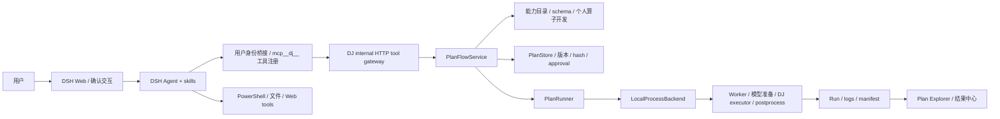
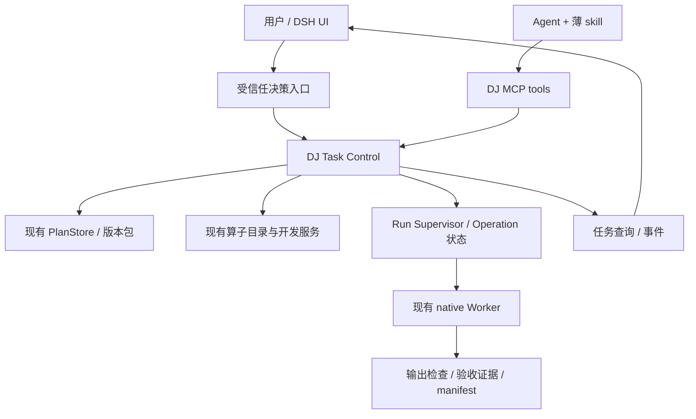

# DSH × Data-Juicer 架构诊断与改造方案

日期：2026-09-10  
状态：以下为修复前的诊断与设计。后续代码实施见 [P0/P1 修复记录](D:/dsh-app/docs/architecture/dsh-dj-p0-p1-implementation-2026-09-10.md) 和 [P2 修复记录](D:/dsh-app/docs/architecture/dsh-dj-p2-implementation-2026-09-10.md)；在线服务尚未切换。

## 1. 结论

保留 **DSH + DJ MCP tools + skill + native Runner** 的总体结构。问题不在于采用了 MCP，也不需要把现有实现推翻成一个大型工作流平台。

当前系统已经有较完整的执行部件，但跨部件的业务契约仍主要由 Agent 和聊天上下文维持：用户批准了什么、处理的是哪版输入、完整输出由谁生成、失败后恢复什么、何时才算完成。这让 skill 越写越长，也让运行成功与用户目标达成脱节。

推荐采用：**薄 skill、服务端任务控制、受信任审批、完整执行契约、可核验交付。**

最优先修复五件事：

1. 审批必须来自真实用户动作，不能只靠模型调用 approve_plan。
2. native 执行必须绑定确定的输入版本，不能只有 recipe 和脚本不可变。
3. 加入请求幂等、超时监督、可确认的取消和恢复。
4. 将全部业务处理纳入 Plan，分开记录执行、验收与交付状态。
5. 简化 skill，并让 UI 从服务端读取任务关联与状态，逐步摆脱聊天历史推断。

本方案面向用户当前优先目标：管线编排、版本管理、及时确认，同时保留能力缺口的扩展通道。暂不建设公共算子市场、复杂 DAG 可视化编辑、分布式调度或多 Agent 平台。

## 2. 证据范围

检查了当前工作区源码、技能、架构文档、已有评测与真实 Plan/Run 制品；DSH 仓库 HEAD 为 `8ab2572`，DJ 仓库 HEAD 为 `5da507c`，工作树有未提交修改，因此审计依据是当前磁盘内容，不能仅以 commit 复现全部结论。

本次新增隔离探针，不启动 DJ executor、不下载模型、不修改真实任务：

```powershell
& 'D:/dj/.envs/dsh-dj/python.exe' 'D:/dsh-app/artifacts/architecture-audit-20260910/probe_plan_boundaries.py' --enforce-desired-contracts
```

结果：退出码 1，输入绑定与 deadline 两个期望契约不满足；重复启动观察到两个 Run。探针使用真实 PlanStore/PlanRunner 与假执行后端，验证的是控制边界，不是一次完整 UI 攻击或真实长时进程实验。

- [探针源码](D:/dsh-app/artifacts/architecture-audit-20260910/probe_plan_boundaries.py)
- [探针结果](D:/dsh-app/artifacts/architecture-audit-20260910/probe-results.json)
- 现有执行/展示测试：`test_execution_backend.py`、`test_plan_presentation.py`，16 passed，14.87 秒。
- DSH 接入三个包现有 Node 测试：37 passed；个人算子纯本地精选 pytest：7 passed。共执行 60 项现有测试，均通过；另有上述新增契约探针暴露缺口。各测试覆盖范围见附件，测试总数不代表端到端验证。

历史 9 月 2 日记录用于确认发生过的问题；新增模型锁、环境锁等已有改动不能被忽略。本次没有重新运行全部模型案例，不对当前语义质量和性能改善幅度作未经验证的承诺。

## 3. 当前真实架构



### 已实现且应该保留

- DSH 配置声明 MCP streamable-http，但实际 dj-bridge 从 `/internal/operator-tools` 获取工具定义并用 HTTP JSON 调用，在 DSH 中注册为 `mcp__dj__*`。DJ 同时提供 MCP server；当前接线不是标准 MCP transport 客户端。另有算子库、Plan Explorer 和结果中心插件。[配置](D:/dsh-app/dj-dsh.patch.yml)、[实际桥接](D:/dsh-app/packages/dsh-user-auth/lib/dj-bridge.js:5)
- `prepare_plan` 规范化 recipe，冻结相关运行信息，保存不可变版本及展示 sidecar。[service.py](D:/dj/data-juicer-1.5.4/data_juicer/tools/plan_flow/service.py:157)
- PlanStore 使用文件锁分配版本，快照脚本并计算 hash；审批检查校验结果与准确 hash。[store.py](D:/dj/data-juicer-1.5.4/data_juicer/tools/plan_flow/store.py:79)
- `run_plan` 和 Runner 均检查版本审批；Worker 是独立本地进程，有 RunHandle 与运行记录。[runner.py](D:/dj/data-juicer-1.5.4/data_juicer/tools/plan_flow/runner.py:41)
- 已有模型 revision/文件锁、运行环境锁，正式 Worker 禁止共享环境自动安装，并在模型准备后启用离线加载。[local_worker.py](D:/dj/data-juicer-1.5.4/data_juicer/tools/plan_flow/execution/local_worker.py:62)
- 个人算子已有 authoring spec、版本制品、测试契约、异步 job 和验证状态，不能描述成“Agent 随手写 Python 就上线”。
- 结果 manifest 提供文件大小和 hash，能做完整性核对；它尚不等于业务验收报告。[result_manifest.py](D:/dj/data-juicer-1.5.4/data_juicer/tools/plan_flow/result_manifest.py:11)

### 主要职责错位

Skill 既在做方案判断，又试图充当状态机、审批政策、错误恢复器和质量守门员。工具能验证某个请求的结构，却不能从自由文本中可靠得知业务步骤是否齐全。UI 又有一部分状态来自聊天工具结果投影，使会话状态与业务状态耦合。

## 4. 已发现的问题及处理方向

| 优先级 | 问题 | 证据与影响 | 修改 |
|---|---|---|---|
| P0 | 审批来源仍依赖 Agent | UI 发送批准文本，桥接注册 approve_plan；hash 保证对象匹配，却不证明用户动作真实性 | 受信任 UI 决策记录及服务端校验 |
| P0 | native 输入未与批准版本冻结绑定 | 探针修改 input 后 Plan hash 不变，materialized recipe 仍读原路径 | 输入 snapshot/ref + 运行前验证 |
| P0 | 完整业务流程未必进入 Plan | 9 月 8 日 Plan 承诺运行后筛选/报告/复制，postprocess/artifacts 却为空 | 输出契约、步骤覆盖、纳入 Plan 的后处理 |
| P1 | 重复请求与主动重跑无法区分 | 连续 start 分配两个 Run；MCP run_plan 无 request identity | 幂等请求键与显式重跑语义 |
| P1 | native deadline 没有完整执行保障 | 过期 handle 的 inspect 仍返回 running；MCP 入口也未暴露运行超时 | 独立 supervisor 管理全流程 deadline |
| P1 | cancel 成功不等于清理完成 | native cancel 发 terminate 后写 cancelled，未等待整棵进程树退出 | cancelling、等待/强停、cleanup_pending |
| P1 | 执行成功与验收通过混用 | worker 汇总路径/步骤数后设 succeeded；manifest 清点文件而不验证业务 | execution/acceptance/delivery 分开 |
| P1 | skill 固定门禁和开发细则过重 | 三次固定确认，普通任务加载大量异常分支 | 单主入口，事件触发确认，开发按需加载 |
| P1 | 跨账号资源边界需统一 | 已有身份鉴权，但部分下游读取依赖 internal token 和路径/聊天关联 | 服务端资源 ownership + workspace registry |
| P1 | UI 结果同步被缓存且状态枚举不一致 | 首次成功 reconcile Promise 被长期缓存；结果卡把 preparing_models 当终态 | 按 Run 刷新、缓存失效、共享状态枚举 |
| P1 | 结果归属与状态从聊天历史推导 | 递归解析 history JSON 发现 origin，结果认领使用 session owner；伪造认领风险未作真实利用验证 | 权威 Run owner 校验、事件驱动投影 |
| P2 | 输入 profile 能力不足且采样范围不清 | 文件主要返回 samples/fields/hash，媒体目录会写 manifest | 显式 profile 状态、字段绑定、计数/抽样范围 |
| P2 | 内置与个人候选评分标度不同 | BM25 归一分与 query token 覆盖率混排 | 返回原始方法/rank，使用排名融合或校准排序 |
| P2 | 声明的 MCP 配置与生效链路不同 | bridge 未使用 transport/failOnStartupError 等配置 | 明确 gateway 命名，统一协议适配与服务端控制 |
| P2 | 部署和兼容性高度依赖本机 | launcher 硬编码源码、Python、缓存和端口，产品/源码/依赖锁存在多个版本面 | deployment manifest、协议版本握手、分层健康检查 |

P0/P1 是修复排序，不把所有项目都视为已经利用过的漏洞。尤其身份、文件权限和审批边界需要按单用户可信环境与多用户部署分别验证。

UI 问题的直接源码见 [结果客户端](D:/dsh-app/packages/dsh-dj-datasets/lib/client.js:44) 和 [计划客户端](D:/dsh-app/packages/dsh-dj-plan-explorer/lib/client.js:138)。这些是当前控制流发现，尚未执行完整浏览器连续两次运行复现。

### 4.1 最有代表性的实际案例

`task_516d919b6b10 / plan_v002 / run_r002` 的五个过滤器使用宽松范围以收集分数；验收要求还包括筛选、剔除原因、阶段计数和图片交付。Plan 文字说明这些由运行后脚本完成，但 postprocess 和 artifacts 为空。Run succeeded，manifest 仅登记 exported.jsonl 和 exported_stats.jsonl。

- [Plan](D:/shishi/.dj/tasks/task_516d919b6b10/plans/plan_v002/plan.yaml)
- [Run](D:/shishi/.dj/tasks/task_516d919b6b10/runs/run_r002/run.json)

这证明该 Plan 不能代表完整交付，不证明后续会话绝对没有补做。修复重点是消除计划外处理，而不是让最终回答写得更谨慎就算完成。

### 4.2 native 与其他后端能力不等价

代码库有 DatasetSnapshotter，但目前可见接线在 Docker backend；当前部署走 native。不能据此宣称 native 已对输入做 Dataset Snapshot。native 的 Plan hash 主要保护计划包及脚本，原始 dataset 和引用媒体仍需要单独保护。

同样，拥有 deadline 字段不等于实现了 deadline enforcement。状态检查和真实进程监督要分别验证。

## 5. 目标架构：增加薄控制层，保留工具边界



Task Control 是 DJ 服务内的应用层模块，初期不单独部署。它协调已有服务，不重写 DJ 算子执行引擎，也不把每次搜索固化成工作流节点。

当前 internal gateway 和对外 MCP 都必须进入同一个 Task Control，使用同一权限、schema、幂等与审批逻辑。可以继续保留现有 gateway；不能只在标准 MCP 中间件加控制，却让实际 DSH 调用绕过。

硬约束只覆盖必须可靠的事情：资源权限、审批、版本绑定、幂等、预算、执行状态和交付。能力选择、查询改写、主观语义解释仍交给 Agent，并通过评测和样本验证改善。

## 6. 最小数据与接口契约

### 6.1 持久化对象

| 对象 | 最小内容 | 真相来源 |
|---|---|---|
| Task | owner、workspace_id、目标摘要、输出约定、conversation_ref | DJ Task Control；conversation 仅关联 |
| Plan | 当前不可变包 + input_ref + 输出/验收契约引用 | PlanStore |
| Approval | actor、目标版本/hash、授权范围、真实决策事件、时间 | 受信任交互服务，DJ 验证 |
| Operation | request_id、payload_hash、task、动作、状态、Run/job ref、deadline | 持久控制存储 |
| Run | 绑定 Plan/input/runtime、执行状态、清理状态、制品 | Runner / supervisor |
| Acceptance | 标准 ID、检查器/人工证据、测量值、通过/失败/未验证 | 检查器与人工评审事件 |

Task 不恢复成长 TaskSpec 问卷。只保存执行和恢复真正需要的信息；缺省字段不自动触发提问。

单机初期可以用 SQLite 保存 owner、decision、operation 和事件关联；Plan 大文件仍保留不可变目录。不要让 SQLite 和 JSON 同时成为同一个字段的可写真相源：控制状态以数据库为准，run.json 可逐步成为兼容投影。迁移期明确写入者，并增加对账程序。

### 6.2 工具兼容策略

保留 inspect_input、search_capabilities、get_capability_schemas、prepare_plan、get_plan、run_plan、get_run、cancel_run 和个人算子工具。

建议增量变化（属于拟议接口，当前未全部存在）：

- prepare_plan：支持 input_ref、expected_outputs、acceptance_checks、request_id；返回审批需求及结构化 blockers。
- run_plan：增加 request_id；同一用户/任务/请求键且 payload 相同返回同一 operation/Run，payload 不同返回冲突。主动重跑使用新请求键。
- get_run：返回 execution_status、acceptance_status、delivery_status、cleanup_pending、结构化失败阶段及日志摘要。
- 增加任务恢复查询，如 get_task；返回关联 Plan、operation、待决策项和下一步允许动作。它不代替现有 get_plan/get_run。
- approve_plan：生产模式要求有效 decision_ref/receipt，或改为仅受信任 UI 可调用；Agent 能申请确认，不能自行签发确认。

request_id 由宿主或客户端为一次逻辑动作产生，并在网络重试中复用，不能让模型每次重试重新生成。记录成功结果后才返回，响应丢失后查询同一 operation。对外部付费 API 的副作用另需供应方幂等支持或结果对账，不能承诺仅靠本地数据库实现全链路 exactly-once。

## 7. 关键流程设计

### 7.1 新任务与确认

检查输入 → 必要业务澄清 → 搜索并编排 → prepare_plan → 展示准确版本 → 用户批准 → run。

只要求方案时停止在草案。明确简单任务无需固定需求确认和“允许生成计划”确认。成本、权限、不可逆影响或业务语义变化时按事件提问。已有准确批准不重复请求。

UI 按钮直接调用受认证的决策 API，后端校验当前用户对 workspace/task 的权限，记录 plan_version/content_hash 和范围。聊天文本可作为解释或唤起确认的入口；若要支持自然语言批准，由宿主的受信任确认机制产生同样的决策记录，不接受模型自报 confirmed=true。

### 7.2 输入冻结

小数据可用现有 DatasetSnapshotter 的思路，适配 native 路径；大数据使用只读不可变对象或版本化存储，避免每次完整复制。

input_ref 应包含 manifest hash、记录 ID、字段绑定和媒体清单/内容身份。仅 hash JSONL 不够，因为 JSONL 引用的图片可能变化。若只做运行前 fingerprint 校验，需明确它不解决运行中变化；正式可复现模式使用稳定快照或具备版本读语义的源。

发现输入改变时，拒绝沿用原绑定并提示重新生成计划/输入版本。对明确允许读取动态最新数据的任务，单独定义动态输入策略并在每次 Run 冻结实际读版本，不能混称静态复现。

### 7.3 缺少算子

Agent 区分搜索未命中、语义不满足与运行环境阻断；针对缺失行为补查或组合现有算子。报告/复制等外围处理使用纳入 Plan 的 postprocess，核心新处理进入个人算子开发。

进入开发时持久化 gap、固定验收契约、样本引用、预算和 operation。开发、模型准备、依赖准备、测试都由 supervisor 计时和取消。错误反馈回 Agent 修改源码，但总尝试预算由后端执行；预算耗尽变为 needs_action，不继续循环。

验证成功后取得已存在的 candidate_id/schema，回到正常 Plan 编排。validated 仅表示测试契约通过；当前任务语义质量仍需对应数据验证。无新增成本且在授权范围内不重复询问开发许可；超出范围才暂停。

个人库入库沿用现有策略，不增加固定发布审批。源码中独立的 CapabilityLifecycle 未接入此个人开发链，不把它当成已生效的公共发布治理。依赖 overlay 的缓存键补充基座 runtime fingerprint 与新增包制品 hash，避免路径不变而基座变化时误复用。

### 7.4 完整管线与验收

业务输出必须对应 recipe/postprocess 中的 producer，不能只写在 risk_notes。计划中声明必要制品，例如 selected_manifest、qualified_images、per_record_decisions、stage_counts。

逐图全部分数与删除原因有时要求“先评分、后统一决策”，不能用上游过滤提前删除样本后再承诺全量评分。检查器需要明确每项分数是否实际计算、跳过原因和删除规则的归因口径。

语义覆盖不能被普通 JSON schema 完全证明：工具做结构与引用完整性，Agent 判断业务映射，样本测试验证效果。机械检查器不得代替主观质量证据。

执行完成后先检查制品存在、可解析、记录关联和必需字段，再执行约定的确定性检查；语义质量按标注集或人工审查记录。失败也保存诊断 manifest 和失败报告，但不发布为已完成数据集。

只有执行成功、必要交付齐全且所有硬验收通过才显示“任务完成”；缺证据显示“已执行，部分验收待确认”。

### 7.5 执行、取消与恢复

Operation 使用 queued/running/waiting_user/succeeded/failed/cancelling/cancelled 等少量状态；不要把检索的每个内部步骤都变成硬状态。

Supervisor 持久化 deadline、heartbeat、进程身份和尝试次数。超时不依赖用户轮询 get_run 才触发。取消先置 cancelling，停止子进程树，等待退出，必要时强停并核实资源释放，最终记录 cleanup_pending=false。

重启后读取活动 operation，检查 PID+创建时间/worker lease。真实仍运行则重新附着；已丢失则标记明确错误并对账，不默认重新启动。完成状态用条件更新避免取消与 worker 完成互相覆盖。

## 8. 权限与运行隔离

现有身份桥接不等于操作授权或沙箱。DSH 已启用 PowerShell/文件工具，native 和个人算子子进程也拥有操作系统权限；仅限制 MCP 参数不能阻止同账号的其他路径改写管理文件。

单用户可信本机可以先实施工具路由限制：托管 .dj/审批记录不交给通用文件工具写入，正式数据处理统一走 DJ，批准凭据不进入模型上下文。必须明确这属于应用控制，不能宣传为对同 OS 用户的强隔离。

多用户或执行生成代码时，使用独立 worker 身份、受限目录权限、最小环境变量和可控网络；需要更强边界时才引入容器/独立执行主机。虚拟环境隔离包不等于权限隔离，AST 规则也不是代码沙箱。

workspace 由后端注册并授权，模型只选择已有 workspace_id；不要把任意绝对路径和普通账号身份组合后视为已获资源授权。内部 token 表示受信任服务调用，不应单独授予任意用户数据访问能力。

## 9. UI、观测与部署

- Plan Explorer 保留结构化展示，但任务列表、Plan/Run 关联和待审批项从 DJ 查询/事件投影获得。聊天工具结果用作入口提示，不作为资源归属的唯一依据。
- 立即可做的 UI 修复：reconcile 成功后可按新 Run 失效/增量执行；preparing_models 显示活动状态；短暂请求失败显示重连并重试；结果刷新独立于计划面板是否打开。历史迁移扫描分页、逐条错误隔离，不能用固定 200 个会话替代完整索引。
- 结果中心展示执行、交付、验收三种状态；提供失败报告入口，避免只看 succeeded。
- 事件关联 user/task/plan/hash/input/operation/run/job；日志按阶段输出摘要与可定位引用，避免 Agent 每次读取完整配置和历史日志。
- 先使用短轮询+cursor/backoff，稳定后按需要加 SSE；不让模型持续忙轮询。
- deployment manifest 记录 DSH 版本与补丁、DJ 源码构建身份、协议版本、runtime lock、模型 catalog 版本、skill 版本。当前 uv.lock 不能独自证明本地修改源码也一致。
- MCP 启动握手报告支持的协议与特性，工具响应尽量紧凑，完整 schema/日志按需读取。
- launcher 参数化 workspace、源码、运行环境、缓存和端口；认证配置必需项与可选观测配置分离。基本规划服务健康与某个模型运行环境健康分开，不因可选 GPU/观测依赖阻断所有文本规划任务。

## 10. 实施拆分与文件归属

| 阶段 | 改动 | 主要位置 | 验收出口 |
|---|---|---|---|
| A：基线与硬门禁 | 保存契约回归；受信任审批；workspace/task ownership；明确工具权限 | user-auth/dj-bridge、plan-explorer、DJ server/service/store | Agent 无 receipt 无法批准；合法用户批准准确版本可执行 |
| B：稳定执行 | operation 幂等、supervisor、超时/取消/重启恢复、输入版本 | runner、execution、dataset_artifacts、新控制存储 | 重放不重复启动；输入漂移被阻止；进程清理可确认 |
| C：交付闭环 | expected_outputs、验收状态、失败 manifest、UI 投影 | validation、local_worker、result_manifest、datasets | 历史“成功但无完整交付”案例被明确拒绝或标未完成 |
| D：体验与扩展 | 精简 skill、按需开发、开发预算、输入 profile、协议/部署整理 | 两个 skills、operator jobs、discovery、launcher | 简单任务一次执行确认；复杂任务按需确认并可恢复 |

开发可以并行，但上线顺序应先确立审批与资源边界，再开放更自主的执行路径。仅修改 skill 无法完成 A–C。

第一批最小交付建议选：审批 receipt + run request_id + native 输入绑定 + expected_outputs 校验 + skill 主入口精简。这批直接改善用户最关心的编排、版本和确认，不以搭建新框架为前提。

结果缓存和状态枚举修复可以作为独立小改动先交付，不必等待整个 Task Control。它们改善可见性，但不能替代后端完成状态和资源归属的修复。

迁移：旧 Plan 保持不可变；新增控制索引可引用旧对象。缺输入锁/可信批准等关键证据的旧 Plan 可查看，重新执行时生成新版本或新的受信任批准，不伪造历史记录。控制协议用 feature flag 分阶段切换；在受控模式中缺新凭据不得静默降级到旧批准方式。回滚保留新数据与日志，不重写旧包。

## 11. 必需回归矩阵

| 用例 | 应有结果 |
|---|---|
| 明确尺寸筛选 | 输入检查到 Plan 连续推进，一次准确版本执行确认 |
| 用户只要方案 | 不运行、不请求多余执行授权 |
| 伪造 confirmed=true 或直接调 approve_plan | 无受信任决策记录时拒绝 |
| 修改批准后 recipe 或脚本 | hash 校验拒绝 |
| 修改批准后 JSONL/引用图片 | 读取固定快照或拒绝漂移 |
| 同 request_id 两次调用/响应丢失重试 | 同一 operation/Run，不重复副作用 |
| 用户主动重跑 | 新 request_id，新 Run，保留来源关系 |
| 两个客户端同时修改旧 base | 明确冲突或明确分支语义，不静默误认为最新版本 |
| 运行超时，用户不轮询 | supervisor 自动停止，状态可恢复 |
| 模型准备/测试/正式 Run 中取消 | 进入 cancelling，核实退出后 cancelled |
| 进程或服务重启 | 对账活动任务，不盲目重跑 |
| 宽松评分 recipe 但缺筛选/报告 producer | 不能宣称完整 Plan/交付 |
| 运行成功但文件缺失/损坏 | delivery failed，任务不显示完成 |
| 算子测试通过但无语义 GT | acceptance unverified，不宣称质量保证 |
| 另一个用户提交他人 task/workspace | 所有入口一致拒绝 |
| 同一页面连续完成两个 Run | 两次结果都出现；preparing_models 不展示为完成 |
| 关闭 Plan 面板或短暂断线 | 结果仍能更新；恢复后状态来自服务器 |
| 普通聊天中出现伪造 Run JSON | 不据此认领结果；资源归属由 DJ 核实 |
| 源码/模型/必要依赖版本变化 | 按协议明确阻断或新版本，不静默漂移 |

评测分两层：确定性契约测试覆盖硬边界；固定业务案例评测 Agent 的选型、提问和语义质量。分别统计模型时间、工具时间、用户等待、重试/轮询、任务成功率、错误完成声明，不能将历史高延迟全部归因于 skill。

## 12. 不采用的路线

- 不把现有两个 skill 合成更大的规范全集。
- 不为每个 LLM 判断建立刚性工作流节点。
- 不立即引入 Temporal/LangGraph；当前单机可先用持久控制模块解决实际缺口。跨机器长任务和运维规模上来后再评估。
- 不将“所有验收都必须自动证明”作为上线前提；无法自动验证的质量明确保持未验证。
- 不把模型锁、账号虚拟环境、internal token 分别误当成输入锁、沙箱或真实用户审批。

可借鉴持久化审批/恢复模式，但不照搬框架：[LangGraph interrupts](https://docs.langchain.com/oss/python/langgraph/interrupts)、[Temporal approval pattern](https://github.com/temporalio/documentation/blob/main/docs/design-patterns/approval.mdx)。

## 13. 附件

- [DSH 接入边界专项审查](D:/dsh-app/docs/architecture/dsh-dj-boundary-audit-2026-09-10.md)
- [个人算子生命周期专项审查](D:/dsh-app/docs/architecture/dj-operator-lifecycle-audit-2026-09-10.md)
- [此前 skill 精简方案](C:/Users/hu/Documents/ChatGPT/dcd分析/dj-skills-simplification-plan.md)

此前方案继续适用于 skill 层；本方案补上其无法单靠提示词实现的后端约束。实施后应以本报告的回归矩阵验证效果，不以规则数量减少或测试总数增加作为成功标准。
