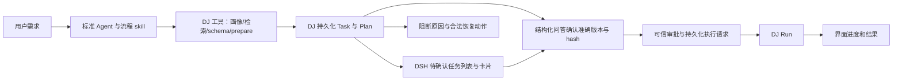

# Langfuse 0790e0b4 复盘与修改方案

日期：2026-09-10；修订：2026-09-11，经用户确认沿用标准 preset，调整诊断/开发边界与审批方式。对象：DSH × Data-Juicer 数据处理流程。

**结论：这次主要不是算子搜索慢，也不是 skill 字数太多，而是规划 Agent 同时承担了编排、补写报表、排查平台源码、恢复卡片和协调审批的工作。工程层只守住了“未批准不能运行”，没有保证“可见、可批准、批准后可继续”。继续增加 skill 命令无法解决这些问题。**

本文件为复盘和修改方案。2026-09-11 已实施核心编排、结构化审批、可靠派发和报告闭环，完成项、实测证据与剩余范围见 [实施记录](./langfuse-0790e0b4-remediation-implementation-2026-09-11.md)。部分隔离与性能验收项尚未完成，不代表本方案全部已实施。环境已按用户授权依照 uv.lock 校准。

## 1. 证据与边界

- [Langfuse 原始 trace](https://jp.cloud.langfuse.com/project/cmtsesk750007ad0frm2llts3/traces/0790e0b44bf1f9ea915f6fbaaaafe0e0)：通过该项目已有配置的只读 API 获取，118 个 observations。
- 对应会话：`session-536f80aa-f4a8-4e9d-9ce2-1627d30a659b`，第 1 轮，工作区 `D:\shishi`，Agent preset 为 `standard`，模型为 `glm-5.2`。
- 时间：北京时间 **20:29:05–20:54:19**。用户给的列表筛选范围没有覆盖整段结束时间，本报告按 trace ID 获取完整记录。
- 对照该会话持久化事件，截取第 1 轮工具事件进行回放；不把后续轮次混入本次耗时统计。
- 定向检查了本条调用链的 skill、DJ 工具契约、DSH 网关、方案卡片投影与审批入口。
- **没有拿到用户当时浏览器的 console、插件版本和卡片挂载记录。** 当前新开的 DSH 验证页面未登录，不能据此重现用户当时界面。当前页面的 401 也不能反推历史卡片故障的原因。

下文分别标记事实、机制判断和待验证问题，不把推测写成已修复根因。

## 2. 实际发生了什么

用户要求：对 `data/images` 保留恰好一张清晰人脸、面积占比 15%–60% 的图片，过滤 NSFW、水印和明显低美学图片，输出实际分数、删除原因、阶段计数。

| 北京时间 | 事件 | 结果与影响 |
|---|---|---|
| 20:29:16 | 加载 plan-flow skill | 已加载简化后的版本，明确规定通过方案卡片审批 |
| 20:29:25 | inspect_input，同时读 2 份 skill 参考文件 | 输入画像成功 |
| 20:29:33 | search_capabilities | 32 ms 返回；只搜索人脸数量/比例、NSFW、水印、美学 4 组行为 |
| 20:29:33–20:31:38 | 搜索后的模型调用 | 124.982 秒，记录的 output tokens 为 6,944 |
| 20:31:38 | get_capability_schemas | 15 ms 返回 5 个算子的参数契约 |
| 20:32–20:39 | 查 postprocess，读取架构文档、旧任务和 DJ 源码 | 编排转成了平台实现探索；旧数据没有先通过任务工具鉴权 |
| 20:40:06–20:42:34 | 写 filter_report.py，用 shell 处理旧 Run 输出，再清理临时输出 | 在正式 Plan 审批前发生了本地后处理和图片复制，不是本次已批准的 Run |
| 20:42:53 | 尝试修改旧任务 task_516d919b6b10 | TASK_FORBIDDEN：旧任务 owner 缺失或不属于当前账号 |
| 20:43:23–26 | 创建新任务 task_db8c179c5909 / plan_v001 | prepare_plan 成功，valid=true，有 content_hash |
| 20:44:40 | 用普通问答询问“批准运行” | 用户选择运行，但没有产生可信后端批准 |
| 20:46:44 | 第一次 run_plan | APPROVAL_REQUIRED |
| 20:47:21–33 | 再问“是否已批准”，随后再次 run_plan | 仍为 APPROVAL_REQUIRED；用户的文字选择不等于审批记录 |
| 20:47–20:50 | 搜索审批服务和卡片源码，继续指导用户找按钮 | 用户明确选择“找不到按钮” |
| 20:51:50 | 用 Agent web_fetch 请求 UI plan-view | HTTP 401；Agent 请求没有浏览器登录态 |
| 20:53:45–46 | 为重新显示卡片创建 plan_v002 | 成功，但用创建业务版本来修 UI，版本和 hash 再次变化 |
| 20:54:19 | 结束回复，让用户点击“应该出现”的卡片 | 没有卡片已显示的证据；本 trace 没有成功创建 Run |

**任务记录确实创建了，用户需要的卡片和执行闭环没有得到保证。** 这两件事不能混为一谈。

## 3. 回答用户提出的四个问题

### 3.1 为什么一直读源码

事实：46 次工具调用里，`read` 13 次、`grep` 9 次、`glob` 4 次，共 26 次文件读取/查找。并非全部是不必要读取：最开始的 2 次是 skill 参考文件；但后续确实扩展到了 DSH 架构文档、DJ 执行器/校验/交付源码、前端源码及旧任务输出。

机制判断有三个层次：

1. **工具契约有空洞。** trace 中 prepare_plan 的 `plan` 是开放 object，没有公开完整的 postprocess 参数、运行目录和报告生成契约；skill 的示例又只有 `postprocess: []`。算子 schema 主要描述输入参数和模型锁，没有稳定的统计输出字段、分数语义和审计输出能力。要求 Agent 完整交付，却没有给它完成交付所需的接口。
2. **工具可用，但缺少明确的使用指引与异常恢复路径。** 实际 preset 是 standard，模型看到了 39 个工具，包括 read/grep/glob/write/pwsh/web_fetch。此次确实发生了源码探索，但不能据此认定标准 preset 或这些工具本身有问题；诊断和自定义算子开发需要它们。应先补齐契约、使用指引与恢复动作，再评估是否需要额外限制。
3. **异常恢复没有确定动作。** 报告怎么生成、旧任务不可访问、卡片不见、审批失败，都被转交给模型自行调查。它于是把数据处理任务当成了开发调试任务。

修改方向：沿用标准 preset，用精简但充分的 skill 指导按需调用，提供完整的 DJ 契约和报告能力；工程层校验授权、审批与执行边界，并返回可执行的恢复动作。**验收关注零无必要源码探索、零脱离任务记录的实际数据处理、零未经授权的跨任务访问，不禁止有目的的诊断和受控脚本开发。** 动态隐藏工具不作为当前方案的必需项。

诊断可以读取相关源码、失败日志和有权访问的历史成功记录。开发可以使用 shell 编写、运行测试脚本；脚本落盘后应固定源码、依赖、输入输出契约及验证证据，注册为自定义算子或受控后处理制品。正式处理纳入 Plan/Run。不能先在 shell 中完成正式数据处理，再补登记来代替执行记录和审批。

### 3.2 搜索已经命中，为什么还想那么久

搜索只耗时 **0.032 秒**，其后的单次模型调用耗时 **124.982 秒**。候选里已有最后采用的 5 个算子，下一步本可以直接批量取 schema。这里不是检索服务延迟。

搜索返回的外层 JSON 序列化长度约 20,457 字符，包含全文描述及 retrieval、ranking、候选标识等信息；详细 schema 还要再取一次。候选相关性、模型能力限制、参数、报告实现和审批交互混在一个规划上下文里，扩大了决策范围。它们是可验证的放大因素，不能仅凭这条 trace 就断言某个因素贡献了多少秒。

方案：搜索默认返回紧凑的候选摘要，命中后批量取 schema；完整检索解释按需展开。每个未解决需求必须有明确编号和缺口，不允许对已满足项反复自由探索。模型调用设置阶段预算和停止条件；模型/推理配置调整用固定样例 A/B 测试，不直接把“换模型”作为根治。

### 3.3 为什么没有创建任务卡片，流程停在那里

已确认：

- 两次成功的 prepare_plan 都返回完整 Plan 引用，分别是 plan_v001 和 plan_v002。
- 原始会话事件的 `surfaceOp` 都在**事件顶层**且为 `append`，seq 分别为 **25524、38288**。
- 使用真实事件回放当前 `projectionDefinition → buildLocationData → turnTail selector`，两份 Plan 都被选中且 valid=true。
- 当前 8 项 plan-explorer 测试通过，但它们没有覆盖真实浏览器插件装载、React 挂载、会话恢复和点击后的自动执行。

因此，**“prepare_plan 没成功”“没有 append 标记”“当前解析器不认识嵌套结果”都不能作为本次已证实根因。** 仍需定位浏览器插件加载/版本、投影运行异常、turnTail 挂载和渲染范围等环节。

已证实的架构问题则不依赖上述前端根因：

- 卡片依赖聊天工具结果投影；最新 Plan 还依赖 PlanCard 挂载时写入浏览器内存 Map。卡片没挂载时，依赖该 Map 的“方案”入口也可能不可用，两个入口共享故障点。
- 没有基于后端任务记录的待确认列表，也没有卡片挂载确认或失败状态可供宿主判断。
- 普通问答被 Agent 当成审批，两次发起必然失败的执行请求。
- 点击审批后的继续执行依赖 `ctx.conversation.send(...)` 再次唤醒模型，而不是可靠的执行调度。
- 用户找不到卡片时，Agent 创建新版本试图修复显示，造成业务版本污染。

修复应同时处理具体 UI 缺陷和恢复能力：**即使聊天卡片完全没渲染，用户仍能通过绑定准确 Plan 的结构化问答批准执行，并从后端驱动的任务列表恢复。卡片只是可选展示，不是审批的必要载体。**

### 3.4 整体为什么这么慢

| 指标 | 实测 |
|---|---:|
| trace 总时间 | 1,514.658 秒，25 分 14.658 秒 |
| 模型调用 | 35 次，累计 1,322.199 秒，约占总时间 87.3% |
| 普通问答等待 | 3 次，累计 183.262 秒 |
| 其他工具 span 耗时合计 | 8.014 秒 |
| 模型报告的 output tokens 合计 | 73,213 |
| 成功 Run | 0 |

说明：工具合计可能含并行重叠，不作为严格关键路径分解；模型 span 包含服务等待/生成，不全部等于推理时间；output tokens 不能直接等同于纯思考 tokens。等待用户的 183 秒也不是计算延迟。

主要损耗来自过多模型往返、长生成、临时编程及错误交互恢复。读取动作本身快，但把大量实现细节带回上下文，增加后续调用和生成。应先缩小模型承担的责任，再优化单次模型速度。

## 4. 另外发现的业务与工程问题

| 问题 | 本次证据 | 修改要求 |
|---|---|---|
| “清晰人脸”未覆盖 | 搜索未单独表达清晰度；最终使用人脸计数和面积比例，没有独立清晰度测量 | requirement coverage 明确标记缺口。检测到人脸不等于人脸清晰；需要清晰度能力或就操作化标准做一次澄清 |
| 实际筛选藏在脚本 | 5 个 recipe filter 的阈值放宽，实质用于打分；脚本再应用正式筛选阈值 | Plan UI 应显示“打分→判定→报告/复制”，不能把打分步骤当作真实过滤步骤 |
| 卡片执行图不完整 | prepare_plan 的 view 为 5 steps/5 groups，但另有 1 个 postprocess | 展示全部执行节点及其输入输出、阈值和产物，postprocess 必须进入视图及进度 |
| 通用后处理承担核心判定 | filter_report.py 不只生成报告，还实现人脸、NSFW、水印、美学阈值判定 | 提供 DJ 管理的声明式决策/审计组件；核心缺口进入受控算子开发，不由通用报告脚本隐式补齐 |
| 错误的非空验收 | qualified 输出 min_files=1、qualified_manifest min_records=1，另有 kept_nonempty | 用户没有要求至少保留一张。零合格图片是合法结果；应验收判定和计数完整，不强迫产出合格样本 |
| 旧任务访问绕过工具边界 | 先直接读旧 plan/run/exported 文件，后续修改该任务才被 TASK_FORBIDDEN 拒绝 | 读与写统一经过 owner 校验；无 owner 任务只能通过显式迁移恢复。不能通过新建任务静默复用未授权历史制品 |
| 旧输出被当作本次预期 | 问答给出保留 4 张/删除 6 张；来源是旧 Run 后处理，本次未成功运行 | 只能标注历史结果/预览及其来源；本次结果必须绑定新的 run_id 和输入、模型、计划版本 |
| 相同方案为 UI 重发创建新版本 | plan_v002 明确为重新显示卡片而创建；返回 diff 含路径、快照 hash、备注变化 | 打开/重显已有 Plan 不创建版本；业务版本、输入身份与 UI 展示生命周期分开 |
| trace 显示 completed，但业务未推进 | end_reason=completed；没有成功 Run | 增加 workflow_state、blocked_reason、pending_action。模型轮次结束不等于业务完成 |

TASK_FORBIDDEN 和 APPROVAL_REQUIRED 本身是有效保护，本次不应通过移除它们解决停滞。需要补齐合法恢复通道。

## 5. 修改后的最小架构

保留标准 preset、现有 DJ 工具与不可变 Plan，不引入通用大型工作流平台。采用“精简 skill + 自足工具契约 + 少量明确的工程控制”。DSH 复用 DJ 的任务、Plan、审批、Run 作为事实来源，只补充会话关联、可靠事件投递、进度观测和 UI 展示状态，不把业务流程编成固定的工具调用顺序。

当前实现与方案须区分：现有 DJ 网关和执行服务已承担账号/任务归属、准确版本审批、运行锁及幂等检查；源码读取、shell 使用和诊断时机主要仍由标准 Agent 与 skill 决定。目前没有实现按状态动态裁剪工具，本次也不把它列为必需改造。



责任分配：

| 层 | 必须负责 | 不再交给它的工作 |
|---|---|---|
| Skill | 理解需求、必要澄清、按需选择工具、证据充分时停止探索、具体故障时诊断、解释方案 | 可靠投递、批准真伪、路径隔离、卡片恢复、执行重试 |
| DJ tools | 自足契约、能力/报告组件、计划验证、版本、批准状态、执行与结果 | 让模型读服务源码才能拼出合法 Plan |
| DSH 宿主 | 会话任务关联、进度和重复动作观测、持久化待办、结构化问答审批、审批后调度 | 通过模型自行声称用户已批准，或硬编码每一步工具选择 |
| UI | 从后端恢复任务和 Plan、展示全部节点、审批、显示阻断/失败 | 依赖模型描述卡片位置或要求重新 prepare |

建议的派生状态为 `planning / needs_input / blocked / awaiting_approval / queued / running / finished`。它们用于恢复、展示和调度，不自动切换 preset 或隐藏工具；必须由 DJ 事实和投递记录推导，不能成为与 Run 状态互相冲突的第二套事实库。`card_ready/rendered/render_failed` 是独立展示状态，**永远不是审批证明**。

## 6. 实施清单

### P0-A：先恢复可见、可批准、可继续

涉及 [plan-explorer client](D:/dsh-app/packages/dsh-dj-plan-explorer/lib/client.js)、[服务路由](D:/dsh-app/packages/dsh-dj-plan-explorer/lib/index.js)、[DJ 网关](D:/dsh-app/packages/dsh-user-auth/lib/dj-bridge.js)及 DJ 任务/审批服务。

1. prepare_plan 成功后，由网关注入可信 session_id，持久化会话与 task_id/plan_version/hash 的关联。不得使用模型传入的身份。
2. 增加已鉴权的会话任务列表/待确认 Plan 查询。会话切换、刷新、重连从后端恢复；聊天投影只作为快速展示路径。
3. 在固定任务区域展示草案状态；Plan 就绪后以结构化问答提供“批准并运行 / 调整方案 / 暂不执行”，附摘要和完整方案入口。卡片可以保留同等操作，但不得成为唯一入口。没有有效 Plan 时显示真实阻断原因，不能出现空白等待。
4. 增加插件 ready、plan received、card rendered/render failed 事件和版本信息。收到 Plan 后若短时间内未渲染，显示直接入口和错误反馈，不让 Agent 重建版本。
5. 当前卡片故障先以真实浏览器 E2E 重现，检查 plugin ready → event received → projection selected → React mounted 各断点。**没有 E2E 证据前，不宣称仅改解析器已修复。**
6. 宿主创建专用 Plan 审批问题，固定 task_id、plan_version、content_hash、approval_request_id。用户回答由宿主以登录身份处理并保存精确版本审批和持久化执行请求。普通需求问答不产生审批，模型不能自行指定 actor 或回填“已批准”。Plan 改变后旧问题不能批准新版本。DSH worker 调用 DJ run_plan，使用稳定幂等键，审批后的执行不再需要 LLM 往返。
7. DJ 和 DSH 不共享数据库事务时采用持久化 outbox/恢复扫描：审批成功而入队响应丢失、入队成功而 Run 响应丢失，都能按同一 decision/request ID 恢复。重复点击只得到同一个逻辑 Run。预算、输入与模型检查继续由 DJ 执行。
8. 立即止损：prepare_plan 返回有效待批方案后停止规划生成、等待可信事件。在上述适配完成前，普通 ask_user_question 的回答仍不能替代 DJ 审批；适配后结构化审批问答是主要入口。APPROVAL_REQUIRED 转为 awaiting_approval，不重试 run_plan。

验收：两份真实事件回放仍通过；新建、历史恢复、刷新、重连均可显示准确版本；普通澄清问答的“同意”不会启动；结构化审批问答可可靠启动一次 Run，重复提交不重复执行；卡片失效不阻断审批，旧问题不能批准新版本。

### P0-B：沿用标准 preset，明确工具使用指引与执行边界

1. 沿用 standard preset，不新增数据处理 preset，不以阶段为由默认禁用 read、grep、glob、write、shell 等工具。skill 指导正常任务优先使用 DJ 契约；已有画像、能力证据或 Plan 可直接恢复，调用顺序可按上下文调整。
2. 保留必要的操作说明和最小示例，详细参数、统计字段、路径语义、报告能力迁入工具契约。skill 参考资源按需读取，不能在删减说明后仍要求 Agent 猜测完整 Plan。先补接口，不以禁读源码代替接口建设。
3. 工具报错、契约冲突或结果不符时，Agent 可围绕具体问题读取相关源码、日志和有权访问的历史成功记录；简要记录问题、检查目标和结论即可，不要求新增模式切换工具或反复请求许可。超出已有授权范围的访问或共享环境修改，才进入相应授权/维护流程。
4. 自定义算子开发允许脚本落盘、shell 测试与验证，使用限定的候选目录和样例范围；源码、依赖、契约及测试证据形成受控制品，正式处理纳入 Plan/Run。标准 Agent 可以调用 authoring 能力，执行环境隔离不等于必须另建 Agent preset。
5. 工程层强制执行资源授权、准确版本审批、执行身份和共享依赖不可被运行任务随意修改等边界。路径规范化及 owner 校验覆盖所有实际访问入口，包含通用文件/shell 路径；只在 DJ API 中检查而允许其他入口绕过，不算完成。既有授权的源码诊断与跨任务访问应被允许。
6. TASK_FORBIDDEN 返回“任务不可访问/需迁移”及可用恢复入口。用户确实要新任务时可以新建，但不能携带被拒绝任务的内部制品来绕过授权。APPROVAL_REQUIRED 等可预期阻断由宿主持久化并提供恢复动作，不交给模型反复试错。
7. 先观测重复检索、同类错误和无新证据的长时间探索，提示整理缺口、形成方案或说明阻断。只有固定测试集证明补齐契约和 skill 后仍不稳定，才另行评估局部动态工具裁剪；不作为本轮实施前提。

验收：同一 standard preset 下，正常已支持场景没有无必要源码探索；注入故障后能按需读取相关源码与成功记录；自定义脚本可落盘、测试、注册并进入 Plan，无需切换 preset。已有证据可以复用，不强制重复画像或检索。绝对路径、相对路径、junction 及 shell 不能绕过未授权资源限制；具备授权的跨任务诊断访问应正常工作。

### P1-A：补齐自足契约与标准报告能力

涉及 DJ plan_flow 的 schema、discovery/catalog、validation、delivery 与 view；不是继续把源码示例堆进 skill。

- prepare_plan 的开放对象改为版本化 Plan schema；至少公开 recipe、postprocess/受控组件、expected_outputs、acceptance_checks 的类型、字段、路径语义和最小例子。
- schema 返回 `input_contract / output_contract / score_semantics / limitations / runtime_requirements`。统计字段名、取值范围、越大越好还是越差、是否支持保留被过滤样本均可查询。
- 增加可复用的 DJ 审计/决策组件，按每张图片的稳定 ID 产生原始分数、各条件判定、首个淘汰原因、全部违规原因、阶段计数和合格图片清单。模型只配置规则，不再临时写 filter_report.py。
- 声明 `audit_mode`：全量打分可保证所有样本都有所有分数，但成本较高；级联执行允许后续字段为 not_evaluated，不能伪造为 0 或缺省通过。通过需求和成本边界选择，并在审批前展示。
- 阶段计数满足输入=保留+淘汰；级联 stage 的 entered/removed/remaining 守恒；与“每个条件独立命中次数”分开。
- 空输入、零保留、单张/多图记录、模型失败均有明确输出语义。除用户明确要求，零保留不视为执行失败。
- 核心能力缺口返回 `not_found / unsupported_semantics / runtime_unavailable`；优先组合现有能力，无法覆盖时停在明确缺口或进入受控开发，不转成源码探索。

本条样例必须单独处理“清晰人脸”。若现有库没有清晰度判定，先显示缺口和拟采用标准；不能把人脸检测结果充当清晰度证据，也不能把用于模糊/匿名化人脸的 mapper 当作清晰度检测器。

### P1-B：缩短模型决策路径

- 搜索默认摘要：每条需求最多 3 个候选，返回能力摘要、匹配依据、适用限制和 schema_ref；完整全文/检索排序细节改为按需查询或调试信息。
- 候选确定后一次批量获取 schema，禁止没有新增缺口的重复搜索。缓存按查询、目录版本、用户权限范围区分。
- 引入轻量 coverage：每条需求只记录 covered / gap / needs_user_input 及证据。它是编排验证输入，不是要求用户填写的新问卷。
- 宿主按阶段记录 wall time、模型调用数、输入/输出 token、重复动作及有无新增证据。对无进展的重复调用先提示整理证据、形成方案或说明缺口；配置重试上限和总预算，触及上限时保留已有 Plan/缺口并返回明确状态，不静默丢失工作。进度控制不等于固定工具顺序或按阶段禁用工具。
- 初始试验目标：已支持场景在无需澄清、无模型下载时，首次可确认 Plan 的模型调用数不超过 8 次，P95 时间不超过 120 秒；搜索后决策阶段目标不超过 20 秒。**这是待压测目标，不是已实现保证。**
- 最大输出/推理参数只使用模型供应商实际支持的配置，通过固定样例测试质量与耗时。超时不可变成静默中断或丢失方案。

### P1-C：版本和执行图符合真实业务

- get_plan/open/present 已有版本不产生新版本；新增展示接口若有必要，必须是幂等且不修改 Plan 内容。
- prepare_plan 增加请求幂等或等价草案去重。输入内容、规则、算子/模型版本、后处理内容变化才构成新业务版本；展示备注与定位信息从执行身份中分离时，要明确定义哈希契约并做迁移，不能直接忽略所有差异。
- 输入 snapshot 的内容身份与物理版本目录分离，避免单纯重新冻结到不同目录造成虚假的业务变更。
- 卡片展示所有 recipe、decision、report/copy 节点。本例应准确表现 5 个打分节点和后续判定/交付节点，而不是“5 步完成过滤”。
- 验收区分 execution、delivery、acceptance。清晰度等主观指标没有证据就标记 unverified，不用 row_count 掩盖缺口。

### P2：观测和回归，防止再次凭感觉排查

- 每个 trace 关联 session_id、task_id、plan_version、content_hash、decision_id、request_id、run_id、服务部署版本、skill 版本、工具契约版本和浏览器插件版本。
- 将规划、人工等待、队列、执行、交付拆成 spans；增加 workflow_state、blocked_reason。日志只记录摘要和标识，避免把数据样本、凭证或整个源码输出作为常规诊断材料。
- 建立固定测试集：已支持过滤、清晰度缺口、零合格图片、旧任务无 owner、未授权读、卡片插件失败、审批重试、刷新恢复、服务重启、重复提交。
- 质量评估与延迟评估共同通过才调整模型配置；单纯 token 下降不代表方案正确。

## 7. Skill 最终保留什么

本 trace 已加载简化版主 skill，requirements skill 只是兼容入口。详细 skill 曾能较好约束行为，不能因为它属于软约束就否定其作用。此前精简保留了完整交付要求，却没有同步补齐报告和 postprocess 契约，把复杂度转嫁给了模型。修订目标是保留必要流程知识、去掉重复和易过期实现细节，并补齐工具接口，而不是单纯缩短字数。

建议主 skill 保持以下责任：

1. 沿用已明确需求，用 inspect_input 获取输入事实；只问会改变结果/成本的必要问题。
2. 搜索能力，批量获取契约；每项要求有覆盖证据或明确缺口。
3. 使用 DJ 原生组件编排，prepare_plan 创建可审查版本；失败按工具提供的恢复动作处理。
4. 展示方案和真实缺口，通过宿主绑定准确版本的结构化审批问答确认；卡片可选，不猜卡片已经出现。普通澄清回答与审批回答在宿主层区分。
5. 读取持久化 Run 和验收状态交付结果。工具错误或结果异常时按需诊断，自定义能力进入受控开发；已有有效证据直接复用，不为遵守列表重复调用工具。

不在 skill 中规定复杂轮询、重试、队列或 UI 注入算法。也不增加固定“需求确认—再确认—执行确认”多轮问卷：需求已明确就进入方案，执行由一次明确的可信结构化问答或等价按钮确认。诊断与开发是正常能力分支，不能把遇到平台问题就无法推进作为设计终点。

## 8. 运行环境漂移与恢复（2026-09-11 补充）

用户报告 RUNTIME_PACKAGE_MISMATCH：torch 的实际安装版本与 uv.lock 的 2.8.0 不一致。核查旧环境发现 torch=2.13.0、torchvision=0.28.0，而锁文件分别为 2.8.0、0.23.0；其他多项依赖也有漂移。错误文本中的 +cpu 后缀与本次元数据不同，不据此推断升级人或升级时间。

当前实现仅在 worker 启动时验证本 Plan 所需的一部分 audited packages，Plan 保存的锁文件指纹不代表整个实际环境已获验证。因此“整套精确依赖图已经验证”的描述过强，且用户审批后才发现环境不兼容，恢复太晚。

**本次用户选择：按现有 uv.lock 构建独立运行环境，验证后切换；不改锁文件迁就新版本。** 旧环境保留为回退依托。安装范围为现有 Windows 服务所需依赖闭包，不强装所有可选的 Linux/GPU extras。严格沿用项目的 OpenCV override，避免多个 cv2 发行包覆盖同名文件。已完成切换；147 个安装包核对通过，DJ 测试 199 passed / 5 skipped，在线指纹一致。详见[环境维护记录](D:/dsh-app/docs/architecture/dj-uvlock-environment-repair-2026-09-11.md)。这次环境恢复不代表下述维护工具和审批改造已经实现。

后续工程修改：

1. 增加 inspect_runtime / prepare_runtime 等受控维护能力：报告目标依赖、实际差异、可用兼容环境和恢复动作。
2. prepare_plan 阶段检查需要的完整依赖闭包及平台可用性；不相关的可选包不阻断任务。运行前再复检以发现审批后的漂移。
3. Plan 引用经过验证的 runtime_id 与环境清单指纹；维护服务创建新环境、验证并发布，不在运行任务中修改共享依赖。
4. 业务 Agent 的 workspace 限制不需要解除。它可向维护服务提交范围明确的修复请求；维护服务具备对目标环境的权限、操作记录和回退能力。扩大访问/资源范围再请求授权；已获授权的环境修复直接执行。
5. 重新批准规则取决于执行身份是否改变：计划原本锁定且获批的同一环境身份恢复后可重试；依赖图、模型或执行配置改变则建立新 Plan 版本，不静默改变已批准计划。
6. 环境不可恢复时持久化 blocked 与具体恢复入口，不让 Agent 只回复“沙箱无权限”后结束。

## 9. 本次已经执行的诊断验证

诊断目录：[0790e0b4](D:/dsh-app/.dsh/diagnostics/0790e0b44bf1f9ea915f6fbaaaafe0e0)。原始 trace 与会话材料含业务上下文，留作本地证据，不作为公开报告附件提交。

```powershell
D:/dj/.envs/dsh-dj/python.exe -X utf8 .dsh/diagnostics/0790e0b44bf1f9ea915f6fbaaaafe0e0/audit-trace.py
```

实际输出中的失败项：

```text
FAIL no_run_attempt_without_trusted_approval
FAIL no_shell_processing_in_planning
FAIL no_duplicate_plan_to_repair_ui
```

这是一条可重复、只读的历史行为审计，不重新执行工具。它锁定本次的未可信批准执行、临时处理与为修 UI 重建 Plan 的具体症状；历史材料不会因修复而变绿。其 shell 检查只针对本条 trace 的 filter_report.py 调用，不代表禁止所有 shell。改造后的行为审计应读取模式、授权和制品/Run 关联，允许受控诊断与自定义算子测试，拒绝脱离记录的正式处理。

```powershell
node .dsh/diagnostics/0790e0b44bf1f9ea915f6fbaaaafe0e0/replay-card.mjs
node --test packages/dsh-dj-plan-explorer/test/*.test.mjs
```

结果：卡片投影回放 PASS，选中 plan_v001、plan_v002；相关测试 8/8 通过。回放加载真实插件，模拟依赖并调用投影/选择器，**不包含完整 DSH 投影引擎、React、浏览器装载和登录状态**。因此它缩小了排查范围，但不能替代“卡片可见且点击后运行”的 E2E。

## 10. 实施顺序与完成标准

先做 P0-A、P0-B，让用户能看到方案、一次结构化确认后继续执行，并使正常编排不无目的进入源码探索，同时保留受控诊断和脚本开发。随后完成 P1 的报告组件、契约和决策预算，使已支持任务无需重复编写报表脚本。P2 把事件、延迟和故障恢复固化为回归验证。

本轮改造完成必须同时满足：

- 同一输入需求能展示完整方案或明确能力缺口；正常编排不无必要读取平台源码，具体故障可进入可审计诊断。
- 卡片在刷新、重连、历史会话中可恢复；渲染失败有独立入口和可诊断状态。
- 结构化审批问答可批准绑定的 Plan；普通澄清回答不能伪装成审批。一次确认可靠创建一个 Run，卡片不是必要条件。
- 报告、实际阈值、清晰度覆盖和零保留情况均有真实契约及测试。
- 用新 trace 验证调用数与阶段延迟，不能只用单元测试通过或“应该出现卡片”作为交付依据。
