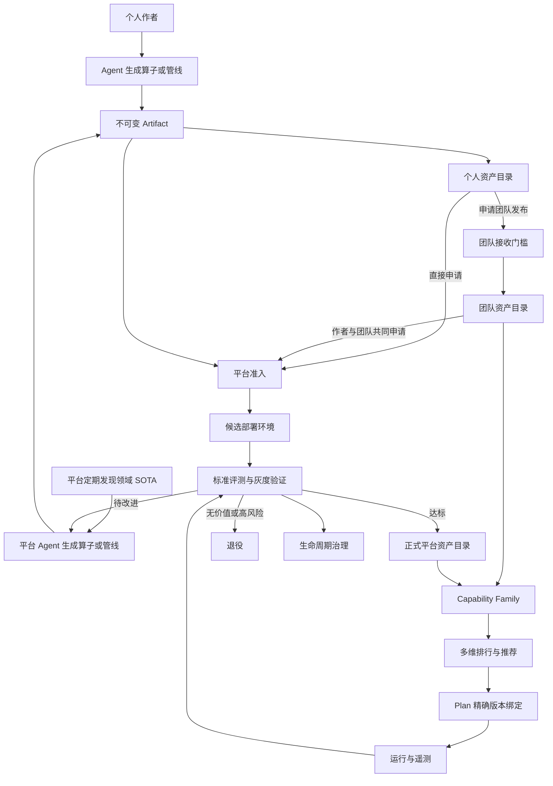
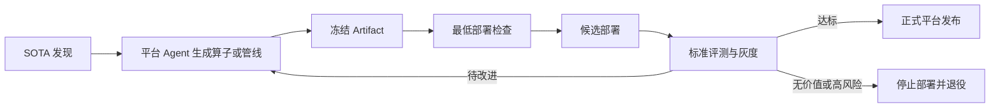

# DSH × Data-Juicer 算子与管线生态治理设计

状态：设计草案
日期：2026-09-09
范围：个人、团队和平台的算子与可复用管线，以及贡献激励、SOTA 补充、评测推荐与日落治理

## 1. 设计摘要

生态中的治理对象包括算子和可复用管线，由三类来源构成：

1. 用户通过 Agent 生成个人算子或管线；
2. 个人将已验证制品发布到团队范围，或直接申请平台贡献；
3. 平台定期发现领域 SOTA，主动生成并部署候选算子或管线。

算子统一为不可变 `Operator Artifact`，可复用管线统一为不可变 `Pipeline Artifact`。团队库和平台库是两个独立发布范围，不是连续等级。团队接收解决内部复用，平台通过准入检查、候选部署和灰测决定是否面向全平台发布。长期无使用价值或存在风险的版本经过弃用、日落和退役，历史 Plan 引用不受影响。

核心原则：

- 能力与算法实现分离；
- 归属范围、成熟度、生命周期分离；
- 跨范围发布精确制品，不复制可变源码；
- 团队目录只收录已证明可用的算子和管线；
- 被团队或平台接收后，由原作者与接收方共同维护；
- 平台 SOTA 资产先候选部署，后持续评测；
- 排行基于同一评测条件下的多维证据；
- 退役替代直接删除，保证历史可复现。

## 2. 目标与非目标

### 2.1 目标

- 支持个人算子和管线独立发布到团队范围或申请平台贡献；
- 支持团队成员共享可用算子和管线；
- 支持平台持续补充领域 SOTA 算子和管线；
- 支持同一能力下多个算法算子的评测与选择；
- 明确算子维护责任、状态和替代关系；
- 通过灰测和奖励机制鼓励有效贡献与持续维护；
- 在不破坏历史 Plan 的前提下完成日落治理。

### 2.2 非目标

- 不允许未经检查的源码直接进入团队或正式平台目录；
- 不以使用量代替质量评测；
- 不以单一排行榜分数决定所有场景的默认算子；
- 不允许晋升过程修改既有 Artifact；
- 不物理删除仍被 Plan、Run 或评测记录引用的版本。

## 3. 领域模型

### 3.1 Capability Family

对一个稳定业务能力的定义，例如“图片水印检测”。同一 Capability Family 可以包含多个不同算法的算子。

### 3.2 Operator Artifact

不可变的算子制品，包括源码、Schema、依赖锁、模型引用、资源、验证契约和内容哈希。任何内容变化都产生新 Artifact。

### 3.3 Asset Release

将一个精确 Operator Artifact 或 Pipeline Artifact 发布到个人、团队或平台范围的记录。Release 保存范围、成熟度、生命周期、维护人和替代关系，不复制 Artifact。

### 3.4 Pipeline Artifact

不可变的可复用处理管线，包含处理图、精确算子依赖、参数模板、输入输出契约和端到端验证证据。具体任务的 Plan 从 Pipeline Artifact 实例化，并继续执行任务级审批。

Pipeline Artifact 按端到端任务场景归入 Pipeline Scenario，例如“图片隐私清洗管线”。

### 3.5 Benchmark Profile

针对一个 Capability Family 的版本化评测契约，固定测试集、指标、阈值、Runtime、硬件和失败分类。

### 3.6 Evaluation Result

一个精确 Operator Artifact 在一个精确 Benchmark Profile 下产生的不可变评测结果。

### 3.7 Promotion Request

作者申请将个人或团队算子的精确版本发布到更高治理范围的审核记录。

### 3.8 Candidate Deployment

算子正式收录前，在平台控制环境中的候选部署。它用于标准评测、影子运行和灰度验证，普通生产 Plan 默认不可选择。

## 4. 状态模型

算子状态由三个独立维度组成。

### 4.1 治理范围

| 范围 | 可见与使用范围 | 接收方 |
|---|---|---|
| `personal` | 作者本人 | 无 |
| `team` | 团队全体成员 | 团队 |
| `platform` | 平台用户 | 平台 |

### 4.2 成熟度

| 状态 | 含义 | 使用限制 |
|---|---|---|
| `draft` | 尚未完成结构或运行验证 | 仅开发过程 |
| `experimental` | 可以运行，但缺少充分质量证据 | 仅个人范围 |
| `validated` | 冻结验收契约已通过 | 可申请进入团队 |
| `production_ready` | 通过平台标准评测和准入审查 | 可进入正式平台目录 |

`validated` 只证明声明的验证范围成立，不代表适用于所有业务数据。

### 4.3 生命周期

```text
active → deprecated → sunset_scheduled → retired → purged
   ↘ suspended
```

| 状态 | 行为 |
|---|---|
| `active` | 正常发现，可用于新 Plan |
| `deprecated` | 降低推荐，提示替代版本 |
| `sunset_scheduled` | 公布退役时间，新 Plan 默认禁止绑定 |
| `retired` | 不进入普通搜索，历史 Plan 仍可解析 |
| `suspended` | 因安全、许可证或严重故障立即停止新运行 |
| `purged` | 零引用且超过保留期后物理清理 |

## 5. 总体架构



## 6. 个人算子与管线

个人算子或管线由作者通过 Agent 生成。算子验证源码、Schema、依赖和运行结果；管线还需验证精确算子依赖、端到端输入输出契约和整体执行结果：

- DJ 接口与 Schema 检查；
- 依赖和模型引用冻结；
- 真实 DJ 执行；
- 验收契约断言；
- 内容哈希计算和不可变发布。

运行通过但缺少有效质量断言时标记为 `experimental`；验收契约通过后标记为 `validated`。只有 `validated` 版本可以申请进入团队。

## 7. 团队算子与管线

团队库是面向团队成员的独立发布范围，不是平台库的前置阶段。个人验证通过后可以申请团队接收；团队主要判断资产是否可用、是否具有复用价值、是否与已有资产重复、是否适配团队 Runtime，以及维护责任是否明确。接收后即成为团队正式资产，可被团队成员检索和使用，不要求进入平台灰测。

### 7.1 成员权限

团队不区分 Viewer 和 Contributor。每个有效团队成员都可以：

- 发现、查看和使用团队算子及管线；
- 将自己的 `validated` 个人制品提交给团队。

提交权不等于接收权。团队指定接收人负责审核申请并承担团队侧维护责任。

### 7.2 团队接收门槛

算子或管线进入团队目录必须同时满足：

1. Artifact 已达到 `validated`；
2. 在团队支持的 Runtime 中 Schema 可解析且执行成功；
3. 没有未解决的高风险安全、许可证、依赖或模型问题；
4. 已公开验证范围、适用场景和限制；
5. 原作者和团队接收人确认共同维护。

接收后创建 team 范围的 Asset Release，原 Artifact 内容和作者署名保持不变。

### 7.3 共同维护

| 责任方 | 责任 |
|---|---|
| 原作者 | 算法实现、缺陷定位、修复和新版本建议 |
| 团队接收方 | 团队 Runtime 兼容、使用反馈、发布状态和生命周期 |

源码、依赖、模型或契约变化时，由作者生成新 Artifact；新版本必须重新通过团队接收，不得覆盖当前版本。

## 8. 平台算子与管线

平台资产有两个入口：用户贡献和平台 SOTA 自动补充。

### 8.1 用户平台贡献

作者可以将个人资产直接提交平台，不要求先进入团队库；已进入团队库的资产也可以由作者和团队共同提交。团队使用记录可以作为平台评审证据，但不替代平台准入与灰测。平台依次执行：

```text
提交精确 Artifact
→ 自动准入检查
→ 候选部署与灰测
→ 人工发布审核
→ 正式发布、延长观察或停止候选
```

自动准入处理能够由系统确定并重复验证的事项：版本与描述信息完整、输入输出契约可解析、维护人明确，并且候选可以在目标环境完成部署和最小运行。确定失败时直接退回并提供检查结果；系统无法判断、需要例外配置或触发平台风险规则时转人工处理。自动准入通过只代表可以进入灰测，不代表平台正式接收。

人工发布审核不重复机器检查，重点判断灰测证据是否充分可信、是否补充平台能力或明显优于现有方案、与已有资产的重叠是否合理、适用范围是否清楚，以及平台与作者是否能够持续维护。审核结果为正式发布、延长灰测或停止候选。

首版由人工确认所有正式发布。规则和数据稳定后，标准能力、低风险且完整达到灰测门槛的候选可以自动发布，平台对其抽检；新能力、非标准运行环境、证据异常、门槛临界或需要规则例外的候选仍必须人工审核。

平台接收后：

| 责任方 | 责任 |
|---|---|
| 原作者 | 算法演进、实现修复和新版本提交 |
| 平台 | 标准评测、平台兼容、运行保障、推荐和日落治理 |

平台接收不是所有权转移。作者退出维护时，平台必须接管、指定新维护人或将算子弃用。

### 8.2 贡献奖励与灰测晋级

平台通过奖励鼓励高价值贡献和持续维护。奖励分阶段确认：

| 阶段 | 条件 | 奖励建议 |
|---|---|---|
| 候选接收 | 通过最低准入并完成候选部署 | 基础贡献积分 |
| 灰测通过 | 达到采用、质量和价值门槛 | 主要贡献奖励 |
| 持续维护 | 正式发布后保持可用并及时修复 | 周期性维护奖励 |

灰测期应设置最短观察窗口和最小有效样本量，参考指标包括：

- 采用：独立用户、独立团队、有效运行和复用率；
- 质量：任务验收通过率、投诉和人工回退；
- 价值：能力补缺或相对现有方案的明确提升。

平台负责分配灰测流量、聚合指标、审核晋级和结算奖励。平台不得按原始调用量直接发放奖励；奖励计算需要去重、最低样本门槛、异常使用检测和申诉机制。管线奖励还要定义对管线作者与底层算子作者的归因规则，避免重复计奖或只奖励最外层资产。

灰测结果分为三类：通过后进入正式平台库；证据不足则延长观察；质量或风险不达标则停止候选部署。贡献者可以基于反馈提交新 Artifact，再进入新一轮灰测。

### 8.3 平台 SOTA 自动补充

平台按领域定期运行以下闭环：



自动准入检查只确认候选信息完整、契约可解析，并能完成候选部署和最小运行。完整效果评测发生在候选部署之后。候选部署不等同于正式平台发布，普通生产 Plan 默认使用正式推荐池；候选资产只能通过受控灰测或用户显式选择使用。

平台生成的算子或管线由平台承担作者和治理责任。平台完成候选部署后运行官方评测，并将同能力算子或同场景管线纳入排行榜。

## 9. 评测与推荐

### 9.1 比较范围

算子排行榜的比较单位必须固定为：

```text
Capability Family + Benchmark Profile Version + Runtime Class
```

不同能力、测试集版本或运行环境的结果不得直接混排。

管线按端到端任务场景比较，固定输入输出契约、数据集、算子依赖和 Runtime。除质量、稳定性、性能和成本外，还要评估步骤兼容性、失败定位、断点恢复和结果可复现性。

平台持续维护测试集、Benchmark Profile、评测基线和排行榜，并在测试集、模型或 Runtime 发生变化时组织复评。

### 9.2 平台部署、评测与排行

平台以不可变 Artifact 为单位完成候选部署和正式部署，并为不同风险等级配置隔离环境、资源限额、熔断和回滚策略。候选版本部署成功后，平台执行官方测试集评测、受控灰测和运行指标聚合，再更新排行榜与推荐结果。

| 环节 | 平台产出 |
|---|---|
| 部署 | 可复现的候选或正式版本、运行环境和回滚点 |
| 评测 | 固定 Benchmark Profile 下的质量、可靠性、性能和成本结果 |
| 灰测 | 采用、质量和价值证据，以及样本量与置信度 |
| 排行 | 同能力、同测试版本、同 Runtime 下可解释的排名与场景标签 |

排行榜展示原始评测结果和证据，不用单一综合分掩盖差异。榜单允许正式与候选版本同榜比较，但必须显著标识生命周期状态。候选版本可以成为“评测领先”，却不能在证据未成熟时自动成为“生产默认”。推荐系统在排行榜证据之上，根据当前任务约束、证据置信度和推荐池计算推荐顺序。

### 9.3 推荐池与流量策略

平台将可推荐资产分为两个池：

| 推荐池 | 准入条件 | 使用方式 |
|---|---|---|
| 正式推荐池 | 已进入平台库且状态为 `production_ready` | 普通生产任务的默认来源 |
| 灰测探索池 | 已完成候选部署，正在收集灰测证据 | 仅用于低风险受控流量、影子运行或用户显式选择 |

灰测不采用全站固定 10% 的平均分流。平台应为每个候选资产设置观察窗口和灰测证据目标，包括最低独立用户数、独立团队数、有效运行数和复用样本数，再按能力流量与风险动态分配探索预算：

- 高频能力可以按比例分流，正式算子仍作为默认推荐；
- 低频能力采用最低采样配额，对匹配任务定向展示候选，并组织目标团队试用；
- 线上自然流量不足时，以影子运行和标准数据回放补充运行与质量证据，但不得将其计为独立用户、独立团队或复用证据；
- 同一能力同时灰测的候选数量应受限，避免探索流量被过度摊薄；
- 达到证据目标即停止继续放量并进入晋级评审，观察期届满仍未达到采用目标则延长灰测、定向招募或结束候选。

候选算子在官方测试集上相对正式版本有明确提升时，可以进入加速灰测，获得更高的定向展示优先级和探索预算；在达到最短观察窗口、最小有效样本量和跨团队证据要求前，不自动替换正式算子。

对尚未通过灰测但表现更好的个人或团队算子，平台同时提供三种方式：

- 在推荐结果中标记为“高潜候选”，并展示提升幅度、样本量和风险；
- 允许用户或团队显式选择，也可采用影子运行与正式算子对照；
- 提高其灰测优先级和采样配额，加快形成晋级证据。

这样既保持官方算子的默认稳定性，也避免优秀候选因身份和冷启动长期无法获得验证机会。

### 9.4 检索与推荐排序

推荐不按官方、团队或灰测身份预先分配固定流量。平台先从当前用户可见的正式算子、团队算子和灰测候选中统一检索，再完成过滤与排序：

1. 硬约束过滤：校验能力类型、输入输出契约、数据权限、Runtime、资源预算、延迟要求、质量底线和生命周期状态；
2. 匹配度排序：根据用户任务描述与算子能力描述、结构化标签和适用条件计算匹配等级；
3. 同等级裁决：匹配等级相同时，依次优先官方正式算子、团队正式算子、灰测候选；
4. 结果解释：展示来源、成熟度、评测结果、样本量、置信度和主要限制。

来源身份不进入匹配度计算，只作为同等级时的稳定性裁决。由于连续分数几乎不会完全相等，平台应将接近的分数归入同一匹配等级，而不是比较浮点值是否相等。首版可以将匹配度划分为“高度匹配、匹配、弱匹配”三级，后续再基于检索数据校准边界。

如果团队算子或灰测候选的匹配等级高于官方算子，可以排在官方算子之前。团队正式算子可以直接被选择；灰测候选必须显著标识其状态和证据完整度，高风险任务要求用户显式确认，并保留官方算子作为回退版本。用户显式指定或团队策略固定的算子不受来源裁决顺序影响。

排行榜与任务推荐保持分离：排行榜反映相同 Benchmark Profile 下的客观能力表现，任务推荐反映当前需求的匹配程度。质量、价值和采用指标用于准入、排行榜、灰测晋级和匹配等级相同时的进一步解释，不与描述匹配度混成难以解释的统一总分。

### 9.5 评测指标

| 维度 | 核心指标 |
|---|---|
| 质量 | 能力对应的准确率、召回率、保真度或业务指标 |
| 可靠性 | 算子异常率、超时率、验收通过率 |
| 性能 | 延迟和吞吐 |
| 成本 | CPU、GPU、显存和单位处理成本 |
| 采用 | 有效运行量、独立团队数和复用率 |

基础设施失败、Runtime 加载失败、算子异常和质量验收失败必须分别统计。

### 9.6 推荐规则

- 质量门槛优先于使用量；
- 使用量只表示采用程度和证据强度；
- 低样本量结果必须降低置信度；
- 评测过期、已弃用或存在风险的版本不得默认推荐；
- 首版采用“质量最佳、CPU 最佳、性价比最佳、最稳定”等场景标签，不设计跨能力统一总分；
- 推荐结果必须展示评测配置、样本量、时间和主要限制。

## 10. 运行遥测

Plan 已绑定精确算子或管线版本，Run 结束后记录最小化事件：

```text
asset_version
asset_kind
capability_id
runtime_class
execution_outcome
failure_category
acceptance_outcome
latency_bucket
resource_bucket
```

遥测不包含业务输入输出内容。重试、取消、平台故障和算子失败必须分开计数。排行榜只读取聚合结果。

## 11. 日落治理

平台持续监控以下日落信号：

| 信号 | 参考指标 |
|---|---|
| 使用衰减 | 连续多个观察周期没有独立用户、独立团队或有效运行，复用率长期低于门槛 |
| 质量退化 | 任务验收通过率持续下降，投诉或人工回退超过门槛 |
| 替代成熟 | 已有正式版本完整覆盖该能力或场景，并在评测或使用价值上明显更优 |
| 维护风险 | Runtime 不再兼容，依赖或模型不可获得，存在安全或许可证问题，长期无人维护 |

低使用率只触发日落候选。普通日落通常要求“使用衰减”与“替代成熟或维护风险”同时成立；严重质量、安全或许可证问题可以单独触发暂停或退役。平台负责引用检查、维护方通知、替代迁移和最终处置。

治理流程为：

```text
发现日落候选
→ 检查引用、唯一能力、季节性和回滚用途
→ 通知作者与接收方
→ deprecated 并配置替代版本
→ sunset_scheduled
→ retired
→ 零引用且超过保留期后 purged
```

以下情况不得自动退役：

- 是某项能力的唯一实现；
- 被活跃 Plan、运行中 Run 或未完成晋升引用；
- 用于应急、合规、回滚或特殊环境；
- 存在有效维护承诺或明确季节性需求。

安全或许可证事件可以跳过常规日落期，直接进入 `suspended`。物理清理前必须完成全局引用检查并保留 tombstone。

## 12. 模块设计

### 12.1 Asset Registry Module

负责算子与管线的 Artifact、Release、精确引用、可见范围和状态。核心接口：

```text
register_artifact(content, evidence) -> artifact_ref
create_release(artifact_ref, scope, maintainers) -> release_ref
resolve(ref, principal) -> resolved_artifact
transition(release_ref, target_state, decision) -> release
```

### 12.2 Capability Catalog Module

负责 Capability Family、Pipeline Scenario 及资产与能力场景的映射，不承担评测和排序。

### 12.3 Governance Workflow Module

负责团队接收、平台晋升、共同维护关系和生命周期决策。

### 12.4 Evaluation Module

负责 Benchmark Profile、候选评测、结果签名和有效期。

### 12.5 Telemetry Module

负责从 Run 事件生成隐私保护的聚合统计。

### 12.6 Recommendation Module

根据能力、运行约束、有效评测和聚合遥测返回可解释的推荐，不修改 Artifact 或生命周期。

### 12.7 Retention Module

负责引用检查、保留期、tombstone 和零引用制品清理。

权限、评分和引用检查必须集中在对应 Module 内，UI、Agent 和 Plan 流程不得自行复制治理规则。

## 13. 与现有系统的衔接

继续保留：

- 个人算子账号隔离；
- 内容哈希版本和验证契约冻结；
- `candidate_id` 精确引用；
- Plan 的 `operator_bindings`；
- 禁止调用方提交 `custom_operator_paths`；
- 批准精确 Plan hash 后执行；
- 运行时物化精确资产版本。

需要新增：

- Team、Asset Release 和共同维护关系；
- Capability Family；
- Promotion Request 和 Candidate Deployment；
- Benchmark Profile、Evaluation Result 和聚合遥测；
- 推荐排序和生命周期状态；
- 全局引用检查及 Retention 策略；
- Pipeline Artifact、端到端验证和依赖归因；
- 灰测状态、奖励台账和反作弊规则。

## 14. 实施顺序

### Phase 1：团队共享与治理状态

- 建立 Team 和团队成员关系；
- 所有成员拥有查看、使用和提交资格；
- 实现团队接收门槛和 Asset Release；
- 记录作者侧与接收方维护人；
- 引入 maturity 与 lifecycle；
- 保证 retired 版本仍可被历史 Plan 解析。

### Phase 2：平台候选与统一评测

- 建立 Capability Family；
- 实现平台贡献审核；
- 实现 SOTA 定期发现、生成和候选部署；
- 建立 Benchmark Profile 和 Evaluation Result；
- 支持评测通过后正式平台发布；
- 支持算子与管线灰测，记录采用、质量和价值；
- 建立贡献奖励台账和人工结算流程。

### Phase 3：推荐与日落闭环

- 从 Run 生成聚合遥测；
- 提供多维对比和场景化推荐；
- 自动产生日落候选；
- 实现通知、替代、退役和零引用清理；
- 建立奖励自动结算、归因和反作弊；
- 将同能力算子和同场景管线纳入排行榜。

## 15. 验收标准

1. 未达到 `validated` 的个人算子或管线不能进入团队目录。
2. 团队成员无需 Viewer 或 Contributor 角色即可查看、使用和提交。
3. 团队接收后同时记录原作者和团队侧维护人。
4. 平台接收用户贡献后同时记录原作者和平台侧维护人。
5. 跨范围发布前后 Artifact 内容哈希保持不变。
6. 平台 SOTA 算子或管线可以先进入受控候选部署，但评测达标前不能用于普通生产 Plan。
7. 排行结果能追溯到能力、算子、测试集、模型、Runtime 和评测版本。
8. 平台故障不会计入算子质量失败。
9. retired 资产不能进入新 Plan，但历史 Plan 仍能解析精确版本。
10. 任何仍被引用的 Artifact 都不能被物理删除。
11. 灰测晋级同时满足质量门槛、最小有效样本量和观察周期。
12. 奖励不按原始调用量直接计算，并能识别重复、异常和自刷使用。
13. 管线评测可以追溯到底层算子精确版本，并具有明确奖励归因。

## 16. 待确认事项

1. 团队接收人由团队长期指定，还是每次申请单独指定？
2. 团队算子默认对全团队可见，是否还需要项目级限制？
3. 团队是否需要独立于平台的 `production_ready` 标记？
4. 作者与接收方是否需要约定最低维护周期和响应时限？
5. retired 版本是否允许历史 Plan 重新运行，还是只允许查看历史结果？
6. 灰测的最短周期、最小有效运行数和晋级门槛如何按能力分类？
7. 奖励采用积分、现金、资源额度还是组合形式？
8. 管线作者与底层算子作者之间如何分配贡献奖励？
