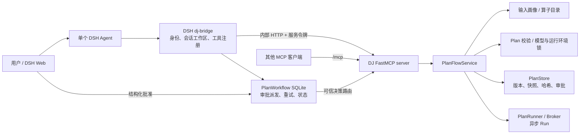

# DSH × Data-Juicer Plan Flow：实现与接手说明

更新日期：2026-09-17。适用工作区：`D:/dsh-app` 与 `D:/dj/data-juicer-1.5.4`。

本文以这两个目录在更新日的**工作树源码**为准，说明已写出的接口和实现。历史测试数据明确标为历史记录；未提交源码、已提交 HEAD 和正在运行的进程不能视为同一版本。本文不包含内部令牌、API Key 或业务数据。

## 1. 一页结论

当前产品使用一个 DSH Agent 理解需求、澄清歧义、选择 DJ 能力并草拟方案；Data-Juicer 的 `plan_flow` 负责输入事实、能力契约、严格校验、不可变 Plan、审批状态和 Run。不是把每个 DJ 算子包装成一个工具，也没有让 MCP 服务再运行一个规划 Agent。

DJ 服务同时提供标准 MCP `streamable-http` 入口 `/mcp` 和内部 HTTP 工具网关 `/internal/operator-tools`。**当前 DSH 实际走后者**：`dj-bridge.js` 发现同一 FastMCP 工具目录，用相同参数模型校验，再在 DSH 注册兼容名称 `mcp__dj__*`。所以工具名前缀表示会话兼容性，不表示当前 DSH 使用了标准 MCP transport。标准 MCP 入口可供其他兼容客户端连接，但 DSH 的账号注入、结构化审批、后台派发与会话恢复还需要宿主适配。

当前默认部署配置是本机 `native` 执行：DSH Web 端口 57035，DJ 端口 8010，DJ Run 由本地进程执行。`broker` 是另一种显式模式，依赖 Runtime Resolver 与 loopback Broker；不要把历史 Docker/Broker 验收直接等同于默认 native 部署。[配置](../../dsh-deployment.json)



## 2. 代码地图与职责

| 位置 | 职责 |
|---|---|
| `D:/dj/data-juicer-1.5.4/data_juicer/tools/mcp_server.py` | `plan-flow` 启动入口，选择 stdio、SSE 或 streamable HTTP。 |
| `.../plan_flow/server.py` | FastMCP 工具注册、内部 HTTP 网关、健康与结果读取路由；工具参数采用 FastMCP/Pydantic 模型。 |
| `.../plan_flow/service.py` | 编排输入检查、检索、Plan 创建/读取/批准和 Run；决定 native 或 broker 路径。 |
| `.../plan_flow/input_profile.py`、`discovery.py`、`operator_catalog_service.py` | 有界输入画像；DJ 内置及个人算子的发现、排序和详细 schema。 |
| `.../plan_flow/plan_contract.py`、`validation.py` | `PlanDraft` 公共契约、DJ 参数/路径/输出/API 策略等校验。 |
| `.../plan_flow/store.py`、`native_inputs.py` | 工作区内 Task/Plan 持久化、输入与脚本快照、内容哈希、diff 和审批记录。 |
| `.../plan_flow/model_lock_resolver.py`、`runtime_environment_lock.py`、`runtime_preflight.py` | 模型绑定、Python 环境锁和按 Plan 的可运行性评估。 |
| `.../plan_flow/runner.py`、`execution/`、`run_status.py` | Run 编号、幂等请求、隔离输出目录、worker、取消、状态和步骤投影。 |
| `.../plan_flow/user_operator_*`、`operator_authoring.py` | 个人算子脚手架、源码预检、验证 job、按账号版本发布和执行绑定。 |
| `.../plan_flow/run_output_gateway.py`、`dataset_artifacts.py` | 验证结果清单、受控读取/下载/删除。 |
| `D:/dsh-app/packages/dsh-user-auth/lib/dj-bridge.js` | DSH 工具发现、账号与 workspace 绑定、协议握手、可信审批工具。 |
| `D:/dsh-app/packages/dsh-user-auth/lib/plan-workflow.js` | 会话 Plan、用户决策、执行 outbox、重试和状态的 SQLite 控制面。 |
| `D:/dsh-app/packages/dsh-dj-plan-explorer/`、`packages/dsh-dj-datasets/` | 方案/运行展示和结果中心本机原型。 |
| `D:/dsh-app/web-dj.ps1`、`web-dj.sh`、`scripts/deployment-manifest.mjs` | 部署配置解析、指纹、预检、服务启动及复用检查。 |

读代码建议从 `server.py:create_mcp_server` 和 `dj-bridge.js:apply` 开始，再沿 `PlanFlowService` 的同名方法进入确定性模块。早期接手文档中“只有九个工具”的表述已过时，以第 3 节的当前注册列表为准。

## 3. 实际提供哪些工具

### 3.1 DJ FastMCP 注册工具

默认 `create_mcp_server()` 注册以下 **15 个**工具。若构造 `PlanFlowService` 时提供 `worker_root`、使 `capability_catalog` 可用，会额外注册第 16 个 `resolve_capabilities`。当前环境创建服务时只传 `execution_mode`，所以不能默认假定该可选工具存在。参数名以下列出主要输入；完整 JSON Schema 应向运行服务做工具发现，或查询对应函数签名。

| 工具 | 主要参数 | 返回/用途与实现要点 |
|---|---|---|
| `inspect_input` | `workspace_root`, `input`, `sample_size=20` | 检查工作区内输入。目录媒体生成 DJ JSONL manifest；文件返回数量、head 样本、字段统计及 `complete/partial/empty/unsupported` 范围。样本不声称代表全量。 |
| `search_capabilities` | `requirements[]`, `modality?`, `executor_type="default"`, `top_k=3`, `include_details=false` | 按每条需求检索并去重候选；默认返回紧凑说明和 `schema_ref`，详细检索证据可选。内置 BM25 与个人候选分数不直接比较，而按来源排名合并。候选分数不是效果保证。 |
| `get_capability_schemas` | `operator_names[]` | 按精确 DJ 名或个人 candidate ID 读取可执行参数契约、输出等详情，用于入选算子的 Plan 编排。 |
| `get_plan_contract` | 无 | 返回版本化 `PlanDraft` JSON Schema（当前 `plan-v1.2`）、`image_audit` 语义、输出结构和审批约定。 |
| `inspect_runtime` | `workspace_root`, `task_id`, `plan_version?` | 读取已授权 Plan 的依赖闭包、运行时评估和恢复动作；只检查，不安装包。 |
| `prepare_plan` | `workspace_root`, `plan`, `task_id?`, `base_plan_version?`, `view_spec?`, `request_id?` | 规范化并校验 Plan，冻结输入、脚本/模型/运行环境信息，保存新 `plan_vNNN`。无效草案也保留审计，但不可批准；稳定 `request_id` 支持重复提交恢复。 |
| `get_plan` | `workspace_root`, `task_id`, `plan_version?`, `include_versions=false` | 返回保存的 Plan、hash、校验结果、展示视图、diff、审批、执行预览和运行时评估。 |
| `approve_plan` | `workspace_root`, `task_id`, `plan_version`, `content_hash`, `note?`, `accepted_gaps?` | 校验准确版本、hash、需求缺口与运行时阻断后写审批。**DSH 不把它直接注册给模型；受控部署只经可信 UI 决策路由调用。** |
| `run_plan` | `workspace_root`, `task_id`, `plan_version`, `request_id?`, `timeout_seconds=3600` | 校验快照/审批/锁后异步启动 Run，返回 Run 状态与引用；受控部署要求稳定 `request_id`。 |
| `get_run` | `workspace_root`, `task_id`, `run_id?` | 查询 Run、步骤、输出、日志/报告位置及失败恢复动作。 |
| `cancel_run` | `workspace_root`, `task_id`, `run_id` | 取消本任务的运行并跟踪清理状态。 |
| `get_custom_operator_authoring_spec` | `category`, `modality="generic"` | 返回当前 DJ 版本的基类、方法、脚手架和模型策略；能力缺口确认后再写源码。 |
| `develop_custom_operator` | `proposal`, `samples`, `parameters?`, `timeout_seconds=180`, `request_id?`, `task_id?` | 源码 AST/契约预检后创建异步验证 job；用 DJ 执行小样本，通过冻结断言后发布个人版本。 |
| `get_custom_operator_job` | `job_id`, `cancel=false` | 查询阶段、结果和清理情况，或请求取消。 |
| `validate_custom_operator` | `candidate_id`, `samples`, `parameters?`, `timeout_seconds=180`, `request_id?`, `task_id?` | 按已发布个人版本的冻结契约重新验证，不能靠更换断言降低标准。 |
| *可选* `resolve_capabilities` | `requirements[]` | 仅配置 `CapabilityCatalog` 时注册；查询已批准可复用 Capability。 |

`service.py` 还实现了 `prepare_capability`、`get_capability`、`approve_capability`，`server.py` 也有相应函数，但它们**不在当前 `tool_functions` 注册列表**，不要在接手时把它们列为线上 Agent 工具。`operator_catalog` 和 `operator_detail` 通过 HTTP 页面路由提供，同样不在上述 FastMCP 工具列表。

### 3.2 DSH 宿主增加的两个兼容工具

| 工具 | 作用 |
|---|---|
| `mcp__dj__confirm_plan(task_id, plan_version, content_hash, retry_of?)` | 宿主重新读取并展示完整固定方案，调用 `userQuestions.ask` 获取实际用户选择。批准后把决策写入 `PlanWorkflow`，由 outbox 走可信 DJ 审批路由并自动启动一次 Run。失败/取消后的显式重试使用 `retry_of`。Agent 不需要随后再调用 `run_plan`。 |
| `mcp__dj__get_workflow_status()` | 恢复当前会话保存的 Plan、审批、派发和 Run 状态及最近活动，不创建新 Plan。 |

DSH 还将发现到的 DJ 工具注册为 `mcp__dj__<tool_name>`，**跳过 `approve_plan`**。桥接会从会话 owner 取得账号，以会话 `cwd` 覆盖模型传入的 `workspace_root`，并为 `prepare_plan`、`run_plan`、个人算子开发/验证注入稳定调用 ID。DJ 内部网关使用 FastMCP 已注册工具的参数模型做验证，而不是另维护一套宽松 schema。

### 3.3 HTTP 路由与工具的区别

`/mcp` 是标准协议入口；`/internal/operator-tools` 是 DSH 的工具发现/调用网关；`/internal/plan-decision` 是可信审批入口；`/internal/health`、`/internal/workspace-access`、`/internal/task-runs` 是服务控制接口。方案 UI 使用 `/plan-view`、`/run-steps`；结果中心使用受内部令牌和账号约束的 `/internal/run-output`、`/internal/run-asset`、`/internal/run-archive`。`/operator-catalog`、`/operator-detail` 服务算子库。HTTP 路由不应自动算作 Agent 可调用工具。

## 4. Plan 从需求到结果如何运行

1. **澄清与探查。** DSH 依据主 Skill 只追问会改变方案或验收的歧义。未知输入事实由 `inspect_input` 探查；文件计数、head 样本与实际媒体质量分别记录，不把样本推断成全量事实。
2. **能力选择。** 用 `search_capabilities` 找候选，再用 `get_capability_schemas` 读取入选项的参数和输出契约。个人算子与 DJ 内置算子在统一目录呈现；检索命中不代表语义已满足。能力缺口明确后才进入个人算子开发流程。
3. **编写 Plan。** `get_plan_contract` 返回 `PlanDraft`。核心字段为 `user_intent`、`recipe`、`postprocess`、`expected_outputs`、`acceptance_checks`、`acceptance_criteria`、`coverage`、`risk_notes`。`recipe` 只能选一个输入源（`dataset_path` / `dataset` / `generated_dataset_config`），`process` 是有序的单算子对象列表；当前校验要求非空。`coverage` 每项为 `covered`、`gap` 或 `needs_user_input`。
4. **准备与冻结。** `prepare_plan` 在 `validation.py` 检查工作区路径、算子名与参数、执行器、API 策略、后处理和输出约束；服务端从目录推导模型绑定与运行环境锁，不信任 Plan 自填的版本或路径。`PlanStore` 分配 `plan_vNNN`、快照脚本与输入、写 validation、view、diff 和 bundle hash。返回 `valid=false` 时仍可查看草案，但无法批准。
5. **用户审查与批准。** `confirm_plan` 以 `task_id + plan_version + content_hash` 重新读取方案，展示全部节点、缺口、输出和成本。用户在宿主结构化问题中选择批准、修改或暂不执行。`needs_user_input` 必须先澄清，`gap` 必须明确接受。只有真实批准选项产生持久决策；DJ `/internal/plan-decision` 才为 `approve_plan` 设置可信决策上下文，`PlanStore` 记录 actor、decision_ref、hash 和时间。
6. **派发与执行。** `PlanWorkflow` SQLite outbox 将同一决策映射为稳定 `request_id`，失败可重试而不重复创建 Run。native 模式的 `PlanRunner` 再验证 bundle、输入快照、批准和锁，创建 `run_rNNN` 及独立输出目录，启动本地 worker；broker 模式必须解析 Runtime 并调用 loopback Broker，缺少配置会报 `BROKER_REQUIRED`。
7. **状态与交付。** `get_run` 查询 starting、preparing_models、running、cancelling 或终态及步骤信息。DSH `PlanWorkflow` 周期性恢复提交、轮询活动 Run；Plan 面板和结果中心分别投影可见状态。Run 的物理输出通过 `result-manifest.json` 校验，业务验收与“进程退出 0”分别判断。当前工作树还加入终态报告 outbox 和会话唤醒，见第 8 节的验证限制。

### 4.1 磁盘与数据库落点

工作区根必须是会话选择的**绝对路径**。业务相对路径以该工作区解析，不以 DJ 源码目录或 MCP 进程 cwd 解析。Task 存在 `<workspace>/.dj/tasks/task_*/`，包含 `task.yaml`、`current.json`、`plans/plan_vNNN/` 和 `runs/run_rNNN/`。Plan 版本目录包含 `plan.yaml`、`validation.json`、`plan-view.json`、`diff.json`、`content-hash.txt`、批准后生成的 `approval.json`，以及冻结的输入和脚本制品。每次 Run 输出位于 `<workspace>/outputs/<task_slug>/<task_id>/<plan_version>/<run_id>/`，避免同名任务或重跑覆盖。

DSH 控制面数据库默认是运行 cwd 下的 `.dsh/dj-workflow.sqlite`，保存会话方案、决策、执行尝试和事件；账号工作区授权登记在 DJ control SQLite。结果中心另有 Catalog 投影。**DJ Plan/Run 文件是执行事实，DSH SQLite 是会话与派发事实；不要把聊天消息或页面缓存当成审批或 Run 的唯一记录。**

### 4.2 校验能保证什么

校验覆盖结构、算子存在与参数、路径边界、快照、哈希、账号/任务归属、运行时阻断、模型固定和声明的输出检查。它不自动证明“清晰人脸”“运镜”“高质量”等业务语义。`acceptance_checks.kind=manual` 仍需人工判断；图片审计的分数和规则只证明其定义的指标。当前 `image_audit` 仅支持约束中的 native、JSONL、默认执行器和 Filter 流程；`cascade` 不代表模型推理量已减少。

## 5. 身份、审批与隔离边界

- DSH 通过会话 owner 注入 `x-dsh-user-id`，内部服务令牌只用于进程间认证；模型不能把 user ID 参数当作授权事实。`workspace_root` 由桥接改为会话 cwd；DJ 再检查已登记 workspace、Task owner 和路径边界。管理端显式登记 workspace，不暴露给 Agent。
- 内部网关拒绝模型直接调用 `approve_plan`，受控部署的 Store 也要求可信决策引用。`run_plan` 还要求准确批准版本及内容 hash、输入/模型/运行时锁和稳定 request ID。重复请求 ID 携带不同参数会被拒绝。
- 服务端限制相对路径逃逸、输入和脚本制品篡改；输出访问以验证过的 manifest 和受控资源 ID 为依据。broker 模式把 Docker 能力隔在 Broker 后，不给 Agent Docker socket 或任意宿主挂载参数。
- **限制：**这些应用层检查不等于通用文件工具和 shell 的操作系统级跨账号读取隔离。历史审计尚未证明该边界，不能宣称多账号任意本地代码执行已安全隔离。[闭环实施记录](langfuse-0790e0b4-remediation-implementation-2026-09-11.md)

## 6. 启动、配置与排障

主要配置是 `D:/dsh-app/dsh-deployment.json` 和 `dj-dsh.patch.yml`；凭证文件由启动器读取，文档与日志不要复制其值。`web-dj.ps1` 生成部署 manifest 和运行 patch，检查 DJ 构建与服务健康，再启动或核对 DSH 的 deployment ID。修改 Python Plan Flow 源码、依赖或环境变量后必须重启 DJ 进程；修改 DSH bridge、Skill 或 patch 后必须重启 DSH Web。刷新浏览器不加载新后端。启动器复用已有 8010 服务时会提示环境文件没有重新载入；不要在真实 Run 中途重启服务。

```powershell
Set-Location D:/dsh-app
./web-dj.ps1 -CheckOnly
./scripts/test-dj-runtime.ps1 -PythonExe D:/dj/.envs/dsh-dj-uvlock-20260911/Scripts/python.exe -DjRoot D:/dj/data-juicer-1.5.4 -Profile planning
./web-dj.ps1 -NoOpen
```

`-CheckOnly` 解析路径、端口与部署身份，不启动在线服务。实际 Python 路径以当前部署清单为准。最小排障顺序：先确认 DSH `/auth/deployment` 与生成 manifest 的 deployment ID，再确认 DJ `/internal/health` 的 planning/account_control 和构建身份；随后看 `get_workflow_status` 的审批/派发状态、`get_plan` 的 validation/runtime_assessment、`get_run` 的错误码与步骤。不要用普通 GET `/mcp` 的 HTTP 状态判断 MCP 协议是否健康，也不要只凭端口监听判定新代码已加载。

常见错误及方向：`WORKSPACE_FORBIDDEN` 查账号工作区登记；`TASK_FORBIDDEN` 查 Task owner；`PLAN_INVALID` 查 validation errors；`CONTENT_CHANGED`/`PLAN_TAMPERED` 查版本与冻结制品；`GAP_ACCEPTANCE_REQUIRED` 查用户是否明确接受未覆盖项；`RUNTIME_PREFLIGHT_FAILED`/`MODEL_NOT_PREPARED` 查锁与模型准备；`SERVICE_RESTARTED` 让桥接重新发现，工具定义变更时成套重启；`BROKER_REQUIRED` 检查执行模式与 Broker 配置。

## 7. 已有验证证据及其范围

- 2026-09-11 的专项记录：DJ `tests/tools/plan_flow` **208 passed、5 skipped**，DSH 相关测试 **39 passed**；真实浏览器曾验证两个 Plan 版本的结构化/卡片批准、Run 成功、刷新恢复和并发重复批准不重复启动。审批 canary 约 12.4 秒只覆盖**预先准备好方案之后**的闭环，不代表完整规划耗时。[实施与验收记录](langfuse-0790e0b4-remediation-implementation-2026-09-11.md)
- 另一次本机 Broker/Docker 人脸场景曾用 500 张输入生成 30 条结果与 30 个 mask，并验证第二个任务复用 Runtime。那证明该历史配置和样例的执行路径，不证明当前 native 默认部署对所有模态已验收。[P0–P8 报告](p0-p8-implementation-report.zh-CN.md)
- 当前接手检查只读核对了源码与本机服务可达性：DSH 根页面返回 200；对 `/mcp` 的普通 GET 返回 406。没有在本次文档工作中执行真实业务 Run、MCP JSON-RPC 握手或全量测试。

## 8. 尚未完成、当前工作树与接手优先级

1. **先固化并复验工作树。** 更新日两仓库都有大量未提交改动；DJ 有多个 `plan_flow` 新模块仍未跟踪。当前 DSH 工作树的 `PlanWorkflow` 增加了终态报告 outbox，bridge 增加会话唤醒，页面增加步骤/进度展示。这些属于**源码已写、尚不能仅凭源码宣布已部署或端到端验证**的内容。接手者先分别查看 `git status --short`、`git diff`、未跟踪文件、部署 manifest 与在线构建身份；不要清理、覆盖或自动提交用户现有改动。
2. **业务正确性门禁。** 历史运镜案例中合法并成功运行的 V1 在六个样本上误判 3 个；V2 同样本 6/6，但同集调参与验证不能证明泛化。正式可复用算法需独立标注集、边界场景及语义验收。当前 `recipe.process` 必须非空，尚不支持纯脚本/纯后处理 Plan；不要为通过结构校验添加不影响结果的装饰算子。[案例复盘](../../DJ_DSH_HANDOFF.zh-CN.v3.md)
3. **规划速度与收敛。** 历史慢会话 49 个模型步骤、约 40 分钟，主因是模型反复决策和过大检索上下文；工具响应缩小与重复请求提示已做，但完整流程 P95、硬预算和简单任务 quick 模式尚无完成验收。一次性小任务不应自动承担正式流水线全部成本。[选型与现状](../research/dj-agent-recommendation-2026-09-12.zh-CN.md)
4. **结果交付。** 结果中心已有本机列表、预览、筛选和下载原型；Run 终态主动触发的持久 Result Publication、正式 `output_contract`、可恢复深链接、长期索引和 S3 Adapter 尚未完成。终态报告 outbox 的当前工作树改动需验证离线重连、重启、重复投递和失败恢复。[结果中心方案](dataset-results-center-development-plan.zh-CN.md)
5. **隔离与运行维护。** 通用文件/shell 跨账号读取隔离、共享运行时自动重建与回滚、完整浏览器 E2E 套件及远端模型/依赖下载全链路仍需验收。不能以单元测试或 Plan hash 代替这些验证。
6. **可能的宿主迁移。** Pi 替代 DSH 是设计计划，尚未执行，也没有同模型端到端对照。若迁移，必须重做宿主账号/审批/后台交付适配，不能只把 `/mcp` 地址换过去。[迁移方案](dsh-to-pi-migration-plan-2026-09-12.zh-CN.md)

建议接手顺序：**冻结并识别当前构建 → 对齐工具/部署身份 → 跑最小无副作用规划与审批恢复回归 → 验证终态汇报和结果发布 → 再评估语义质量、性能及 Pi 迁移**。每一步分别记录代码版本、运行服务版本、测试数据和结果，避免把“实现了接口”“测试通过”和“业务已上线”混为一谈。
