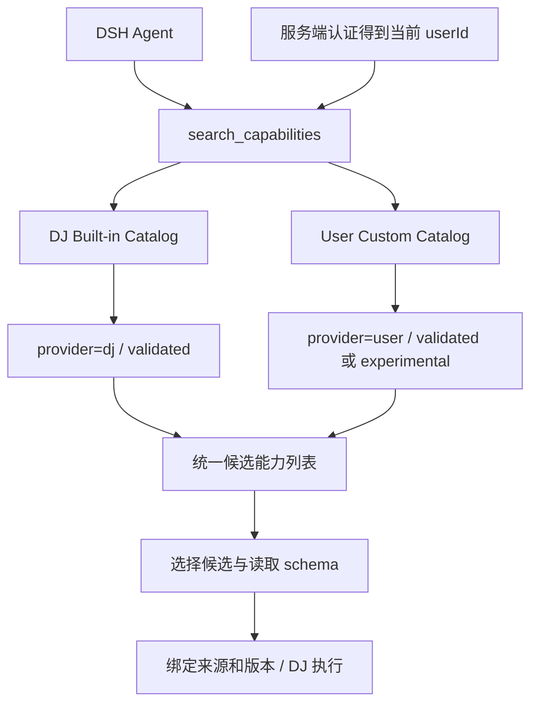

# DJ 与用户自定义算子统一发现及执行：设计开发方案

日期：2026-09-07  
状态：native 首版已实现，交付与限制见第 12 节。正在运行的 DSH/MCP 未由本次开发强制重启；需重启两者加载新接线。

执行范围：仅采用本地 native 进程执行；本轮不考虑 DockerBackend、broker 或容器部署，不将其作为开发或上线前置条件。

## 1. 设计结论

采用 DSH Agent → search_capabilities → DJ Built-in Catalog / User Custom Catalog → 候选能力列表的框架。

自定义算子的实现方式效仿 DJ：继承 Mapper、Filter 等基类，使用标准注册装饰器、参数和 recipe.process，复用 DJ executor。增加的内容仅用于账号归属、验证记录、版本定位及统一发现。

用户自定义算子可以补齐 DJ 的能力缺口，也可以改善已有 DJ 算子的效果。测试达到声明的验收条件后，自动成为当前账号的 validated 算子，供当前任务和后续对话调用。进入个人库不增加审批步骤；正式业务执行沿用现有 Plan 确认。DJ 正式库的 Promotion 仍独立进行。



`validated` 不代表适用于所有任务。DJ 的该值表示内置发布状态，用户算子的该值表示通过特定测试契约。两者均需单独判断当前任务适用性和运行环境是否可用。

## 2. 开发前的实现与缺口（历史快照）

以下事实基于当前本地代码：

| 模块 | 当前行为 | 本次需要补齐 |
|---|---|---|
| DJ ops 注册表 | 导入内置算子后注册到 OPERATORS | 保持内置发现独立，禁止个人算子污染服务进程注册表 |
| plan_flow/discovery.py | OPSearcher、BM25、精确名称查找；searcher 有进程级缓存 | 增加用户候选来源、统一排序和按用户隔离的缓存 |
| plan_flow/service.py | search_capabilities 直接转发 DJ discovery | 接入可信账号上下文和个人 catalog |
| get_capability_schemas | 根据名称读取内置 schema | 支持 provider、算子 ID、版本组成的引用 |
| validation.py / prepare_plan | 内置 schema 校验；部分外部名称通过 capability_bindings 放行 | 从服务端个人库解析真实版本及 schema，不能信任请求中自报的外部名称 |
| custom_operator_paths | 支持外部 Python 文件和包；前次已修复 Windows worker 导入路径问题 | 根据 Plan 中的个人版本引用按需生成路径 |
| DSH user-auth | 已有 principal.userId 和 session_owners 归属关系 | 将账号上下文传到 MCP 检索、验证和执行 |
| CapabilityLifecycle | 已有 prepare、validate、approve、publish 的能力治理机制 | 不直接拿其审批状态代替个人算子的自动验证发布 |

水印算子当前源码在 `D:/shishi/custom_operators`，已验证直调及本地 DJ 配方执行，但没有个人 catalog，也没有充分的效果验收证据。迁移后初始状态为 experimental。

本方案交付 native 模式的完整闭环：通过现有 PlanRunner 和 LocalProcessBackend 启动本地 Python 进程，在该进程中加载指定的自定义算子并交由标准 DJ executor 执行。测试和正式运行均采用这条链路。

## 3. 目录与账号归属

按 mapper、filter、selector、deduplicator、aggregator、grouper、pipeline 分类。分类参照 DJ 的算子类型，不机械复制其全部内部目录。

新增服务端配置 `DSH_USER_DATA_ROOT`。本部署建议默认使用 `D:/dsh-app/.dsh/users`，部署时可配置其他持久路径。该路径是新增配置的建议值，不是当前已存在的用户目录约定。

```text
<DSH_USER_DATA_ROOT>/<userId>/
├── custom_operators/
│   ├── mapper/
│   │   └── image_watermark_remove_mapper/
│   │       ├── operator.json
│   │       └── versions/<content_hash>/
│   │           ├── operator.py
│   │           ├── schema.json
│   │           ├── dependencies.lock.json
│   │           ├── model_refs.json
│   │           ├── assets/          # 算子专用的小型词典、模板、规则
│   │           ├── validation-contract.json
│   │           └── validation.json
│   └── filter/ ...
├── operator_runtimes/        # 依赖组合对应的运行环境
└── operator_tmp/<testId>/    # 一次性测试目录
```

源码、算子专用 assets 和运行环境归当前 DSH 登录账号；模型权重复用 DJ 和对应模型后端现有缓存，不设 operator_resources，也不按每个算子复制模型。多人由同一 Windows 服务用户运行时，不以 Windows USERPROFILE 判定 DSH 用户。模型缓存按当前部署及进程配置使用，不能据此推导 DSH 账号归属。任务只保存来源和版本引用。

`operator.json` 保存稳定 ID、分类、显示名称、版本列表和当前 validated 版本指针。版本目录不可原地修改。源码、schema、依赖锁、资源哈希或测试契约变化均创建新版本；测试报告时间戳不参与版本内容哈希。

目录可作为持久事实源，第一版不必单独引入 catalog 数据库。以小型 JSON 元数据构建用户级检索索引，索引可重建；发布使用账号内锁和原子替换，防止并发产生半成品记录。

### 3.1 已核实的模型缓存规则

2026-09-07 根据当前 DJ 源码和 `D:/dj/.envs/dsh-dj` 已安装后端核对如下。下表默认路径按当前操作系统用户 hu 展开；独立 Python 探针的结果不代表已经运行的 MCP 进程环境。

| 使用路径 | 配置和行为 | 当前独立 Python 探针结果 |
|---|---|---|
| DJ 自有模型缓存 | DATA_JUICER_MODELS_CACHE；默认是 DATA_JUICER_CACHE_HOME/models；后者默认 CACHE_HOME/data_juicer，CACHE_HOME 默认 ~/.cache | C:/Users/hu/.cache/data_juicer/models |
| DJ 通用 assets 缓存 | DATA_JUICER_ASSETS_CACHE；默认 DATA_JUICER_CACHE_HOME/assets | C:/Users/hu/.cache/data_juicer/assets |
| DJ 外部本地模型查找 | DATA_JUICER_EXTERNAL_MODELS_HOME | 未设置 |
| Hugging Face Hub | HF_HUB_CACHE 控制 Hub 缓存；默认 HF_HOME/hub，HF_HOME 未设置时通常使用 ~/.cache/huggingface（也受 XDG_CACHE_HOME 影响） | C:/Users/hu/.cache/huggingface/hub |
| 当前 Transformers | 显式 cache_dir 优先；未指定时当前版本仍识别 TRANSFORMERS_CACHE 及旧变量，最终默认指向 HF Hub 缓存 | 未设置额外覆盖时使用上述 Hub 路径 |
| PyTorch Hub | 显式 torch.hub.set_dir 优先；否则 TORCH_HOME/hub，默认 ~/.cache/torch/hub（也受 XDG_CACHE_HOME 影响） | C:/Users/hu/.cache/torch/hub |

DJ 并不把所有后端模型统一下载到 DATA_JUICER_MODELS_CACHE。应沿用具体加载函数所属后端的机制。

`model_utils.check_model` 在非 force 模式下先检查传入的本地路径，再检查 DATA_JUICER_EXTERNAL_MODELS_HOME 中按 os.pathsep 分隔的搜索目录，最后返回 DJ 模型缓存路径。注意当前实现只有 force=True 分支执行下载；不能把“返回缓存路径”解释成“模型已下载成功”。`check_model_home` 则只将外部根与模型名拼接检查，不支持与 check_model 相同的多根搜索语义。

HF 的 repo/revision 缓存、DJ 的文件名缓存和 PyTorch Hub 缓存各有自己的规则。模型引用需保存 backend、模型 ID 或来源、固定 revision（适用时）、文件清单与哈希。DJ 单文件缓存没有天然的版本保证，执行前需复核文件哈希；发生变化时重新解析或验证，不能静默使用替换后的权重。

当前环境未安装 ModelScope，因此本次不宣称确认了其实际版本和生效目录。后续算子若使用 ModelScope、Ultralytics 或其他后端，应核对该版本加载入口的缓存配置；不得将 HF 或 DJ 默认目录直接套用到所有后端。显式本地模型路径继续受支持，无需迁移既有权重文件。

### 3.2 启动配置一致性与开发调整

当前 web-dj.ps1 定义 HF_HOME 为 `D:/shishi/.cache/huggingface`，但只在启动 DSH 的环境映射中显式注入；MCP 的环境映射未注入该值。MCP 可能继承父环境中的其他设置，因此不能认定 DSH、MCP 及其 worker 已经共用这个目录。web-dj.sh 也未显式统一这些模型缓存变量。

开发时在服务端启动配置集中解析缓存设置，并传递给 DSH、MCP、测试子进程和正式执行子进程。保留部署已有的显式覆盖，统一传递 CACHE_HOME、DATA_JUICER_CACHE_HOME、DATA_JUICER_MODELS_CACHE、DATA_JUICER_ASSETS_CACHE、DATA_JUICER_EXTERNAL_MODELS_HOME、HF_HOME、HF_HUB_CACHE、当前 Transformers 兼容变量以及 TORCH_HOME/XDG_CACHE_HOME 等相关值；变量需在导入后端前生效。

对现有 Windows 启动器，优先使 MCP 和 worker 使用与 DSH 相同的已配置 HF_HOME，且检查 HF_HUB_CACHE 等更具体的覆盖。其他缓存继续沿用已有 DJ/后端配置，不自动搬迁历史缓存。本次只修改设计文档，没有修改启动器或移动模型。

验证时记录各实际子进程解析出的缓存路径，并通过一个既有模型的复用验证确认没有第二份下载。测试数据处理缓存单独放入临时目录，模型缓存永久保留；两者不得用一次递归清理混在一起删除。

## 4. 统一候选的数据格式

保留现有 name、type、description、tags、signature、parameter_descriptions 等字段，增加以下字段：

| 字段 | 用途 |
|---|---|
| candidate_id | 唯一候选引用；同名的两个 provider 不碰撞 |
| provider | dj 或 user |
| operator_id | 个人库内稳定 ID；DJ 可使用原生注册名 |
| version | 用户内容哈希；DJ 使用其源码/发布身份定位 |
| status | validated 或 experimental |
| validation_basis | builtin_release 或 user_acceptance_tests |
| validation_summary | 已验证范围、主要指标及限制 |
| runtime_status | available、blocked 或 unknown，独立于质量状态 |
| replaces | 可选，记录改善的 DJ 算子引用 |

示意：

```json
{
  "candidate_id": "user:watermark-removal:<hash>",
  "name": "image_watermark_remove_mapper",
  "type": "mapper",
  "provider": "user",
  "operator_id": "watermark-removal",
  "version": "<hash>",
  "status": "experimental",
  "validation_basis": "user_acceptance_tests",
  "validation_summary": {
    "execution_passed": true,
    "acceptance_passed": false,
    "limitations": ["尚未验证水印残留率和非水印区域保真度"]
  },
  "runtime_status": "available"
}
```

候选无需暴露宿主绝对路径，执行侧根据引用解析路径。账户归属由服务端维护，不能由 Agent 传入 owner 字段决定。

## 5. 检索与选择规则

1. search_capabilities 取得可信账号上下文，查询 DJ 和该账号的用户 catalog。
2. 继续复用 BM25 和 DJ 的检索字段；用户记录按相同字段建立索引。
3. 合并候选时按候选引用去重，不能仅按名称去重。两个独立索引的 BM25 分值不直接比较，使用排名融合，并对精确名称命中优先处理。
4. 任务适用性优先。同等适用时，优先 validated；内置 DJ 可作为同等条件下的优先项。已证明更适合当前需求的个人算子可以排在 DJ 之前。
5. experimental 默认可以被发现，但带明确状态。Agent 先做任务验证，或在 Plan 中明确标注试用性质；不得把它描述成已满足效果要求。
6. 用候选引用批量读取完整 schema 后再编排。保留原有按名称查询方式，仅用于不含歧义的 DJ 调用。
7. 无满足要求的候选时允许生成。已有 DJ 候选不达标时同样允许生成，记录不适用证据或小样本比较结果。

用户索引缓存键包含 userId 和 catalog revision。DJ 基础索引独立缓存。没有认证上下文的请求只允许内置发现或返回身份错误，不得查询任意个人目录。

## 6. 生成、测试和自动发布

状态流转：

```text
draft → testing → validated
                → experimental（运行通过，但效果证据不足）
                → failed（执行错误或明确未通过验收）
```

draft、testing、failed 不进入普通候选列表。旧 validated 版本在新版本测试失败后仍然可用；新版本通过后原子更新当前版本指针，已保存 Plan 继续引用旧版本。

测试契约先于效果验收固定，包含输入输出字段、使用场景、指标、阈值和限制。生成 Agent 不能通过删除失败断言或降低阈值将失败版本自动变成 validated。业务需求改变时建立新的契约和版本。

测试包含：

- 注册与参数：基类、类型、schema 和注册名匹配，不能覆盖 DJ 注册名。
- 数据契约：空样本、异常输入、输出字段和文件有效性。
- 标准配方执行：真实 DJ executor，包括当前 Windows spawn 路径。
- 任务验收：与声明用途相符的样本及量化指标；改善 DJ 时记录对照结果。

通过后自动发布到个人库，触发索引更新，当前 Agent 可立即再次读取 schema 并继续规划。无需再次重启 MCP，也不新增个人发布审批。生成、测试和发布的进度由同一个开发任务追踪。

执行成功与质量通过分开记录。当前水印算子不能仅凭烟雾测试升级为 validated。

## 7. 测试文件用完即删

每次测试在账号专属 operator_tmp 下分配唯一 testId。输入使用复制的小样本或生成夹具，输出、调试图片、临时脚本、数据处理中间缓存和原始日志都写入该目录。运行必需的模型缓存沿用第 3.1 节目录，不放入该临时目录，也不随测试结束删除。

测试进程结束后先生成精简报告，再在 finally 中清理整个本次测试目录。失败、取消和超时同样清理；先终止并回收子进程，避免清理后 worker 又写入文件。原始业务输入、算子源码及正式业务输出不属于清理对象。

保留内容：源码版本、schema、依赖锁、测试契约、样本指纹、指标、错误摘要及清理结果。测试脚本可以在下一次测试时根据契约重新生成，不长期留存测试图片和输出。

进程崩溃留下的目录由服务启动或恢复时对账，确认没有活跃测试后清理；不能仅按目录年龄删除仍在执行的任务。清理失败需标记 cleanup_pending 并重试，不能报告“已清理”。

## 8. Plan 校验与执行

继续使用标准 recipe.process。来源和版本放在 Plan 元数据中，不能混入算子参数：

```yaml
recipe:
  process:
    - image_watermark_remove_mapper:
        save_format: png
operator_bindings:
  - step_index: 0
    provider: user
    operator_id: watermark-removal
    version: <content_hash>
```

prepare_plan 验证 step_index、注册名、账号归属、版本状态、内容哈希及完整参数 schema。实验状态和验收限制显示在 Plan 中。不能使用请求自行提供的 external_operator_names 作为信任依据。

执行前再次验证绑定和运行依赖，选择兼容的 DJ 运行环境，在独立执行进程中按需加载指定的外部版本。查 catalog 的 MCP 进程不导入用户 Python。内部 materialized recipe 使用服务端解析的 custom_operator_paths，用户不能通过该字段读取另一账号源码。

同名问题采用第一版约束：自定义算子不得与 DJ 注册名冲突；替代 DJ 的实现使用独立名称和 replaces 记录。同一运行若引用同一个人算子的不同版本，也显式拒绝，不尝试在一个 OPERATORS 字典中覆盖加载。

需要额外依赖时在账号运行环境中准备。一个 Plan 的多个算子先合并依赖约束；冲突时返回冲突包和版本要求，不能在共享 DJ 环境反复安装覆盖。资源和依赖准备完成后 runtime_status 才能标记 available。

账号归属校验覆盖 catalog 查询、版本解析、Plan 绑定和运行入口。本地 Python 进程沿用服务进程的操作系统权限，独立依赖环境用于解决包版本兼容问题，不提供操作系统级文件访问隔离。本方案适用于受信任的本地算子代码，不承诺隔离任意 Python 代码对其他目录的直接访问。

## 9. 开发模块与接口

统一 UserOperatorStore 模块承担目录、版本、状态、索引和清理记录。查询及执行层通过该模块解析引用，避免分别扫描目录。

建议新增文件位于 `data_juicer/tools/plan_flow/`：

| 文件（建议名） | 职责 |
|---|---|
| user_operator_store.py | 用户路径解析、版本持久化、状态发布及引用解析 |
| user_operator_validation.py | 临时测试生命周期、结构化报告、进程回收和清理 |
| operator_catalog_service.py | DJ 与个人索引的统一发现及 schema 查询 |

对外开发接口建议为 develop_custom_operator（开始开发）、get_custom_operator_job（状态/报告）、validate_custom_operator（验证已有草稿）。工具名称为方案约定，尚未实现。调用者只传需求、候选引用和任务上下文；userId 来自认证层。

复用并修改：discovery.py、service.py、server.py、validation.py、runtime_preflight.py、runner.py 及 execution/local_process.py。LocalProcessBackend 负责选择账号运行环境中的 Python、启动执行、跟踪状态和回收进程。DSH 侧修改 user-auth 的可信会话上下文传递、MCP 调用适配及 operator-library 的展示逻辑。

当前 MCP 使用共享连接，因此必须先实现逐调用身份传递或按会话隔离的代理。内部认证头由可信 DSH 服务端注入，绑定当前 session 与 userId；不能新增一个由 LLM 自填 userId 的工具参数来模拟隔离。

算子库界面提供“全部 / DJ / 我的”来源筛选和 validated / experimental 标签；详情展示验证范围、版本和不可用原因。公共 `/operator-catalog` 可继续提供内置列表；个人或合并列表须走带认证的 DSH 路由。

个人算子库可复用现有 OperatorArtifact 的哈希和制品引用格式；个人自动发布独立实现，不依赖 CapabilityLifecycle 的审批流程或额外的运行时组装服务。运行准备只需解析指定版本、检查依赖并选定本地 Python 环境。

## 10. 开发顺序及验收

| 阶段 | 交付 | 验收条件 |
|---|---|---|
| P0 账号上下文 | userId 到检索、校验、执行的可信传递 | 两个登录账号无法交叉读取、执行个人算子 |
| P1 个人存储 | 分类目录、版本、状态、原子发布 | 跨任务复用；新版本失败不影响旧版 |
| P2 统一发现 | 双 catalog、排名融合、引用式 schema | DJ 和个人候选同时返回；发布后立即可见 |
| P3 生成验证 | 开发任务、测试契约、报告、自动发布与清理 | 成功可用；失败不进入 validated；取消也清理 |
| P4 执行接线 | 参数校验、版本绑定、依赖环境、按需加载、统一缓存配置传递 | DJ 与自定义混合配方成功执行；重启后可复现；同后端同版本模型复用现有缓存 |
| P5 展示和迁移 | 来源/状态展示、水印算子迁移 | 水印以 experimental 进入正确账号目录；旧测试产物按明确清单清理 |

必要测试覆盖：

1. DJ 缺口：生成个人 Mapper，测试通过，当前任务执行，下一个对话直接检索复用。
2. DJ 效果不足：保存对照依据，生成独立命名实现，达标后在同类任务优先选择。
3. 混合配方：DJ Filter + 用户 Mapper，经标准 executor 运行并导出有效结果。
4. 状态：仅运行通过但效果未验证的算子仍为 experimental；失败版本不进入普通检索。
5. 账号权限：用户 A 无法通过 catalog、候选引用、Plan、提交路径或缓存命中用户 B 的算子；此项验证服务接口权限，不代表操作系统级代码隔离。
6. 复现：保存 Plan 后发布新版本，原 Plan 仍执行原哈希；篡改源码时执行拒绝。
7. 清理：成功、异常、取消、超时及服务崩溃恢复后临时文件清零，原始输入不变。
8. 平台：Windows spawn worker 可导入外部版本；服务 catalog 不随执行注册而改变。
9. 模型缓存：DSH、MCP、测试及正式 worker 的有效配置一致；测试结束模型仍存在，数据处理临时缓存已清理；模型内容变化能被版本校验发现。

完成标准：用户描述需求后，DSH 能发现两类候选、按需生成和验证个人算子、继续执行并在后续对话复用；全过程保留可追溯版本及精简报告，测试文件用完即删。DJ 内置 catalog 的内容由正式 DJ 库决定。

## 11. 代码依据

- `D:/dj/data-juicer-1.5.4/data_juicer/config/config.py`：load_custom_operators。
- `D:/dj/data-juicer-1.5.4/data_juicer/utils/cache_utils.py`：DJ 缓存环境变量及默认路径。
- `D:/dj/data-juicer-1.5.4/data_juicer/utils/model_utils.py`：check_model、check_model_home 和各后端加载调用。
- `D:/dj/.envs/dsh-dj/Lib/site-packages/transformers/utils/hub.py`：当前 Transformers cache_dir 与兼容变量逻辑。
- `D:/dsh-app/web-dj.ps1`、`D:/dsh-app/web-dj.sh`：启动进程的缓存配置传递。
- `D:/dj/data-juicer-1.5.4/data_juicer/tools/plan_flow/discovery.py`：OPSearcher、搜索和 schema。
- `D:/dj/data-juicer-1.5.4/data_juicer/tools/plan_flow/service.py`：发现、Plan 校验和能力治理入口。
- `D:/dj/data-juicer-1.5.4/data_juicer/tools/plan_flow/capability_lifecycle.py`：现有能力验证审批发布流程。
- `D:/dsh-app/packages/dsh-user-auth/lib/identity-access.js`：principal 与 session_owners。
- `D:/dsh-app/dj-dsh.patch.yml`：当前共享 MCP 接入及 catalog 路由配置。
- `D:/dj/data-juicer-agents/data_juicer_agents/tools/dev/develop_operator/scaffold.py`：外部算子脚手架参考。

## 12. 本次交付、使用方式及明确边界

### 已落地

- DSH 使用 `@dsh-dj/user-auth/dj-bridge` 接入 DJ 工具定义，保留 `mcp__dj__*` 工具名。每次执行从可信 Agent/session owner 取得账号，经带内部令牌的 `/internal/operator-tools` 转发；不接受模型指定账号，workspace_root 也由当前会话覆盖。
- DJ 与个人 catalog 统一发现，按候选引用读取 schema；DJ 索引继续独立缓存，首版个人目录实时读取、不做跨账号共享缓存，因此发布后无需重启即可发现。
- 个人算子按类型存储，内容哈希版本、完整目录原子提交和 current 指针发布；`drafts/<jobId>` 保留生成源码、依赖资源声明及冻结契约，不保存测试输入、原始日志或输出。
- `get_custom_operator_authoring_spec`、`develop_custom_operator`、`validate_custom_operator`、`get_custom_operator_job` 已实现。authoring spec 按当前 DJ 版本及 mapper/filter/selector/deduplicator/aggregator/grouper/pipeline 类别返回基类、注册方式、必需/禁止方法、modality 约定和源码脚手架。测试走 `PlanRunner → LocalProcessBackend → DJ executor`；内部测试批准只覆盖临时夹具，不代替业务 Plan 批准。
- `develop_custom_operator` 在创建 job、冻结契约或复制测试媒体前执行 AST 源码预检；错误以 `OPERATOR_SOURCE_INCOMPATIBLE` 和 `source_preflight.diagnostics` 同步返回。异步失败另外标记 schema/execute/contract/publish 阶段，避免 Agent 把接口错误误判为长任务。
- 业务 Plan 绑定个人算子时校验账号、step_index、注册名、版本、schema、源码/资源哈希、模型文件指纹和依赖；禁止提交 custom_operator_paths 绕过。子进程再次检查被物化的源码和资源。
- 个人代码始终使用账号目录下的 Python 环境，显式引用现有 DJ 环境的包；新增精确锁定依赖只装到个人环境。与 DJ 已安装包版本冲突时阻断，不覆盖共享安装。一个配方合并后的依赖组合需已有验证环境，否则返回 OPERATOR_RUNTIME_BLOCKED。
- 图片、音视频样本复制后测试（最多 50 MB），数据缓存和 DJ 产生的媒体输出都导向本次临时目录。成功、失败、取消、超时统一清理；查询中断任务时核对 PID 和创建时间，恢复回收。清理失败保留 cleanup_pending，允许后续重试。
- 启动脚本统一继承 DJ、HF、Transformers、Torch、ModelScope 缓存配置，保留显式环境覆盖。运行时记录实际缓存路径。小型文本 assets 与模型引用分开；本地模型固定 sha256，远端模型声明要求不可变 revision。未创建 operator_resources 模型副本。
- 算子库页面增加“全部 / DJ / 我的”、验证状态筛选和版本/验证摘要；提供刷新按钮。DSH 中英文计划流程同步改为个人生成测试闭环及 native 执行，不再要求 Docker。

### 工具调用约定

能力缺口确认后，先调用 `get_custom_operator_authoring_spec(category, modality)`，并从返回的 `source_scaffold` 开始生成；不得猜测其他 DJ 版本的基类或方法。`develop_custom_operator` 的 proposal 包含 `name`、`category`、`source`，以及可选的 `dependencies`（完整额外依赖精确锁）、`model_refs`、`assets`、`replaces` 和 `validation_contract`。samples 为小型 JSON 记录列表；parameters 为本次验证参数。预检通过后工具立即返回 job_id，使用 get_custom_operator_job 查询；cancel=true 请求取消。

首版契约支持：`purpose`、`row_count`、`equals: [{row, field, value}]`、`limitations`。同时冻结样本/媒体内容和参数指纹，不能在失败后换样本或降低标准升级状态。修改业务契约使用新算子 ID。

只有执行成功且通过非空的声明输出断言时才标为 validated；仅运行通过或只有行数检查仍是 experimental。**这不是通用图像/语义质量评分器**：水印残留率、保真度、模型精度等仍需后续专门验收适配，不能通过几条 JSON 断言推断视觉质量达标。

返回个人 candidate_id 后，使用 get_capability_schemas 加载完整参数，并按第 8 节填写 operator_bindings；业务任务仍须 prepare_plan → 用户批准 → approve_plan → run_plan。

### 水印迁移与清理

本机认证库仅有账号 `shenglei`。水印算子已迁入：

`D:/dsh-app/.dsh/users/usr_ynhK4QU9dT9wcTQP-O8GXlt0/custom_operators/mapper/image_watermark_remove_mapper/`

引用：`user:image_watermark_remove_mapper:dd9138ad54e3bf8f2f00157ab495e20ce541ec8503cf59c4f372cd8dcb4d727a`。

状态 experimental；只做了 OpenCV fallback 的运行验证，尚未验证 LaMa、去水印质量或保真度。原图不变，迁移和复验的 operator_tmp 已清空。原工作区源码副本已移除，可从个人不可变版本恢复；旧 smoke 输入、配方及测试脚本也已删除。历史 smoke_runs、旧时间戳测试目录及 __pycache__ 的批量清理被工具策略阻止，仍保留在原目录，没有绕过限制。

### 部署和验收范围

从更新后的 web-dj.ps1 / web-dj.sh 重启 DSH 与 plan-flow 服务后，新接线生效。只刷新网页不足以更新已加载的后端模块；本次没有强制终止正在使用的服务。首次应用更新不等于后续每次个人发布都要重启。

自动测试覆盖个人源码不污染服务注册表、同账号即时发现、跨账号拒绝、冻结契约、失败不替换旧版、内容篡改、依赖冲突、模型文件指纹、真实混合配方、取消/超时清理及认证 HTTP 接线。既有模型的大文件下载复用、远程模型后端的完整推理、额外依赖的联网安装，以及真实登录浏览器交互尚未做端到端验收；不能把路径继承测试当作这些验收已通过。

验证记录：`tests/tools/plan_flow` 与 `tests/config/test_config_functions.py` 合计 213 passed、5 skipped；DSH datasets / plan-explorer / user-auth 范围的 Node 测试 37 passed。新增 authoring 模块通过 Black 与 isort 检查，相关 Python 文件通过编译检查。Docker 相关跳过项属于既有测试，本次未新增 Docker 实现。
